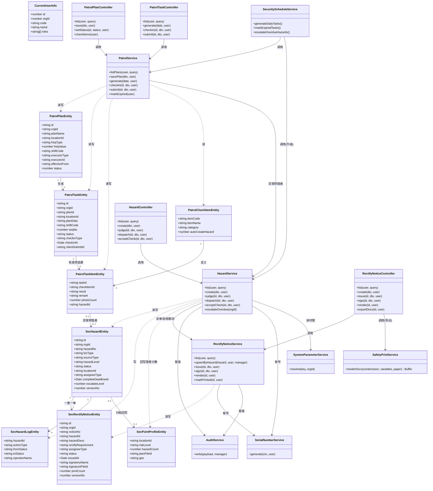
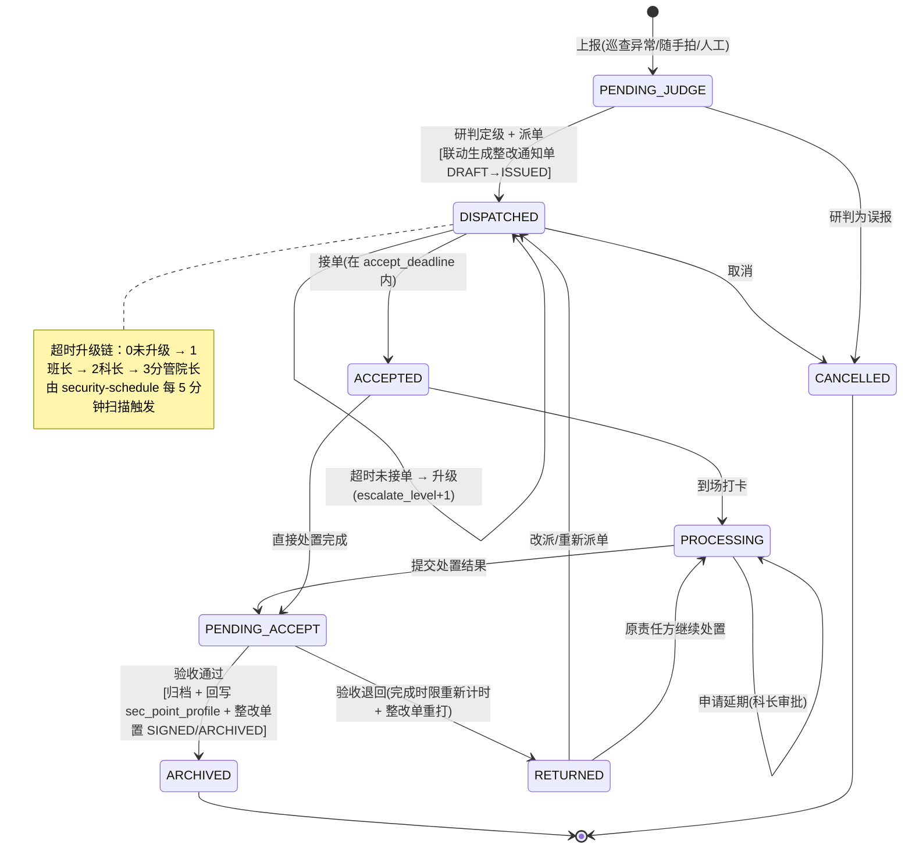
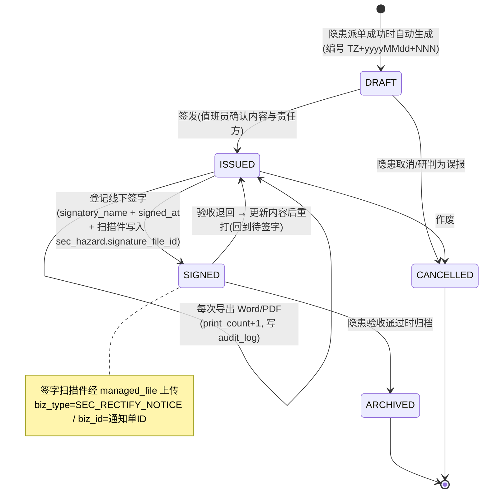
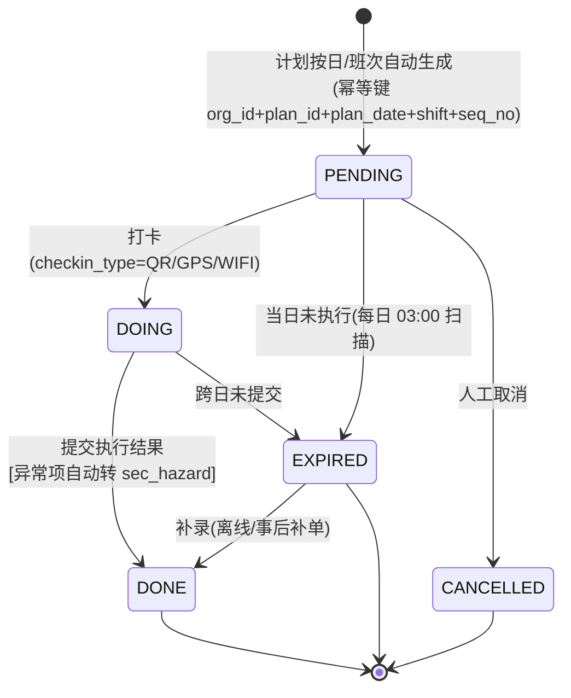
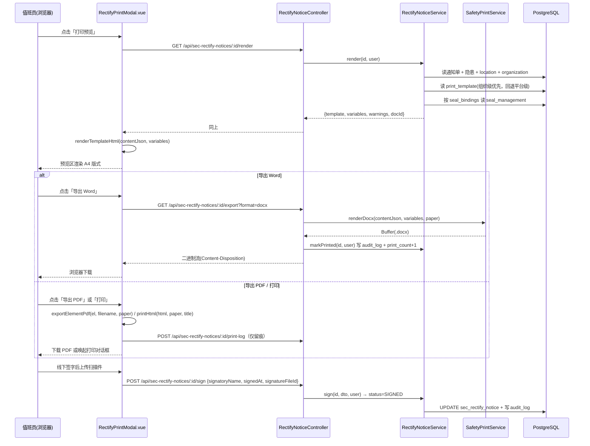
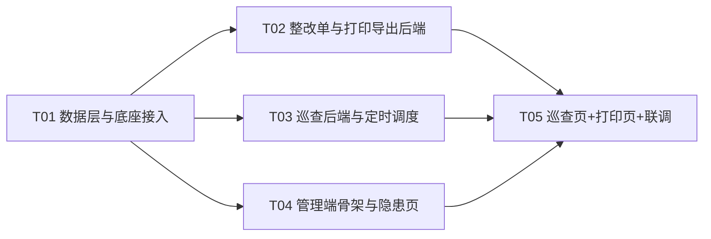

# 医院智慧安全管理系统 · 一期最短业务闭环 增量架构设计

> 版本：v1.0 ｜ 日期：2026-10-10 ｜ 作者：架构师
> 闭环范围：**巡查 → 隐患上报 → 整改单 → 导出 Word/PDF 打印签字**
> 事实源：`_wuzi_src/`（物资系统真实代码）+ `database/migrations/postgresql/049-security-closed-loop-phase1.sql`
> 本文是**增量设计**：已存在的表/接口/页面不重做，只补齐缺口。

> ### ⚠️ v1.1 修订（2026-10-10，读完工程仓库实测后）
> **本文 §0.1 / §0.2 描述的是「参考副本 `_wuzi_src`」的状态，它含有未提交的安全资产。
> 真正的工程落点 `C:\Users\Lok\WorkBuddy\医院智慧后勤系统`（分支 `feature/safety-phase1`）是干净的 —— 既没有 `049` 迁移脚本，也没有 `src/security/` 模块。**
> 因此：这些资产**不是"已存在可跳过"，而是"需要先迁移过去"**。
> 迁移动作已并入 **T01**，见 §11.2 与 §11.3。任务总数不变（仍为 5 个）。

---

## 0. 现状盘点（先读，这是增量设计的地基）

### 0.1 已经存在的东西（不要再建）

> 本节内容是**参考副本** `_wuzi_src`（`master` 分支 + 未提交改动）中的状态。
> `git status` 显示 `apps/business-api/src/security/`、`database/migrations/postgresql/049-security-closed-loop-phase1.sql`、
> `docs/requirements/安全隐患闭环一期/` 三项均为 `??`（未跟踪），`app.module.ts` 为 `M`（已修改）。
> **工程仓库需先把这些迁过去，才能沿用本节结论。**

| 层 | 已存在 | 出处（真实文件） |
|---|---|---|
| 迁移脚本 | `049-security-closed-loop-phase1.sql` 已建 10 张表 + 底座扩展 + 初始化字典/规则/参数 | `database/migrations/postgresql/049-security-closed-loop-phase1.sql` |
| 后端模块 | `apps/business-api/src/security/`（`security.module.ts` / `security.entities.ts` / `hazard.controller.ts` / `hazard.service.ts` / `dto/hazard.dto.ts`） | 已在 `app.module.ts:37` 注册 |
| 隐患闭环 | 上报/研判/派单/接单/到场/处置/验收/退回/归档/延期申请/延期审批/超时升级 **全部已实现** | `hazard.service.ts` 全文 |
| 表 | `patrol_plan`、`patrol_check_item`、`patrol_task`、`patrol_task_item`、`sec_hazard`、`sec_hazard_log`、`sec_hazard_assign`、`sec_hazard_approval`、`sec_rule`、`sec_point_profile` | 049 |
| 底座 | `organization`(org_id 即租户) / `location` 五层树 / `department` / `app_user` / `data_dictionary` / `serial_number_rule` / `print_template` + `seal_management` / `managed_file`(已扩 `biz_type`/`biz_id`) / `audit_log` / `system_parameter` / `org_feature_entitlement`(已开 `SECURITY`) | 049 + `init.sql` |
| 打印底座 | `print_template.content_json`（元素布局）+ 印章绑定 + `render` 接口 + 前端 `headlessRenderer.ts`（HTML 渲染 / `printHtml` 浏览器打印 / `exportElementPdf` 直出 PDF） | `print-template.service.ts`、`views/system/print-template/headlessRenderer.ts` |

### 0.2 缺口（本次要补的，共 5 块）

| # | 缺口 | 说明 |
|---|---|---|
| G1 | **巡查模块无 Service/Controller** | `patrol_*` 四张表已建，Entity 已写，但没有任何接口——巡查是闭环第一步，完全不可用 |
| G2 | **整改单不存在** | 049 已登记编号规则 `SEC_RECTIFY_NOTICE`（TZ 前缀），但没有表、没有接口、没有页面 |
| G3 | **导出打印未落地** | 管理硬性要求（决策#12）。`DOC_TYPES` 里没有安全单据类型，`VARIABLE_CATALOG` 没有变量定义，Word 导出能力完全没有 |
| G4 | **定时调度缺失** | `escalateOverdue()` 已实现但没有任何 `@Cron` 调用；巡查任务生成也没有调度 |
| G5 | **管理端 0 页面** | `views/security/` 是 RBAC 权限安全（角色/审计），不是安全业务板块；安全板块前端完全空白 |

### 0.3 已发现的两个必须修的缺陷（写进 T01）

| # | 缺陷 | 证据 | 修法 |
|---|---|---|---|
| B1 | **隐患单号日期段缺失** | 049 插入 `date_format='yyyyMMdd'`（小写），而 `SerialNumberService.dateText()` 只认 `'YYYYMMDD'`（`serial-number.service.ts` 私有方法），`DATE` 占位符渲染为空串 → 单号会变成 `YH001` 而非 `YH20261009001` | 050 脚本执行 `UPDATE serial_number_rule SET date_format='YYYYMMDD' WHERE rule_code IN ('SEC_HAZARD_NO','SEC_RECTIFY_NOTICE_NO')` |
| B2 | **安全单据类型不在 `TARGET_TYPES` / `DOC_TYPES`** | `TARGET_TYPES=['REQUISITION','PURCHASE','DELIVERY','OUTBOUND','SETTLEMENT','APPROVAL']`（`serial-number.dto.ts:4`）；`DOC_TYPES` 同构（`print-template.dto.ts:18`）。不改则后台 UI 无法维护安全侧编号规则与打印模板 | 两个常量数组各追加 `SEC_HAZARD`、`SEC_RECTIFY_NOTICE` |

### 0.4 目录口径修正（与任务书的差异，按真实代码对齐）

| 任务书约定 | 真实仓库 | 本次采用 |
|---|---|---|
| 后端 `apps/business-api/src/modules/safety/` | **无 `modules/` 目录**，模块平铺在 `src/<name>/`；且 `src/security/` 已被安全板块占用 | 沿用 `apps/business-api/src/security/`，不新建 `modules/` |
| 前端 `apps/admin-ui/src/views/safety/` | `views/security/` 已被 RBAC 占用（角色权限/审计日志） | 采用 `apps/admin-ui/src/views/safety/`（与任务书一致，避开冲突） |
| 迁移脚本 `1xx-safety-*.sql` | 已用到 049 | 采用 `050-*`、`051-*`（`1xx` 与 `050` 不冲突，但顺延更易读） |

---

## 1. 范围界定

### 1.1 本次做（4 周内可演示）

| 域 | 内容 |
|---|---|
| 巡查 | 巡查计划 CRUD（点位/频次/班次/责任人/有效期）；检查项字典复用；按日自动生成巡查任务；PC 端执行页（打卡 + 逐项勾选 + 拍照 + 提交）；异常项自动转隐患工单；逾期任务标记 |
| 隐患 | **直接复用现有 `hazard.service.ts`**，仅补一处联动：派单成功时自动生成《隐患整改通知单》；补 PC 端页面（列表/详情时间线/上报/研判/派单/验收） |
| 整改单 | 生成 / 签发 / 打印 / 签字登记 / 归档；打印次数与留痕 |
| 导出打印 | Word（服务端真 `.docx`）+ PDF（复用前端 `headlessRenderer`）+ 浏览器打印；打印模板登记进 `print_template`；印章变量沿用 `seal_management` |
| 调度 | 巡查任务生成（每日）、逾期标记（每日）、隐患超时升级（每 5 分钟） |
| 权限 | 9 个权限点（见 §4.5） |

### 1.2 本次**明确不做**

一站式服务入口（报修/报服务路由）、摸底建档、安全大脑规则引擎配置页、可视化平面图与点位拖拽、风险区自查、作业票、培训、特种设备、第三方绩效、统计报表、小程序（uni-app）、Flowable 接入、AI 视觉通道。

### 1.3 预留但不实现（结构先留好，将来不加表/不改目录）

| 预留位 | 落在哪 | 将来怎么用 |
|---|---|---|
| 平面图坐标 | `sec_point_profile.plan_file_id` / `.geo`（新增，见 §2.2） | 二期点位拖拽标注直接写这两列，不动 `location` |
| 风险区 | `location.polygon_json` / `.risk_level`（049 已扩） | 二期多边形圈划直接复用 |
| 巡查检查项扩展 | `patrol_check_item`（已建，`org_id` 可为 NULL 表示平台级） | 补充检查项只插数据，不动代码 |
| 流程引擎 | `sec_hazard.business_key` / `.process_instance_id`、`sec_rectify_notice.business_key` / `.process_instance_id`（均已建） | 接 Flowable 时按 `business_key` 幂等关联 |
| 隐患来源扩展 | `sec_hazard.source_type` 已有 `SELFCHECK`/`BRAIN` 枚举值 | 自查/大脑只需传不同 `source_type` |
| 单据类型扩展 | `sec_hazard.biz_type` 已有 `REPAIR`/`SERVICE` | 一站式服务入口直接复用本表分区 |
| 打印类型扩展 | `DOC_TYPES` 本次追加 `SEC_HAZARD` 占位 | 后续作业票/体检报告照抄模式 |
| 附件归属 | `managed_file.biz_type` / `.biz_id`（049 已扩） | 任何单据挂附件都走这两列 |

---

## 2. 数据模型

### 2.1 本次新建/变更的表总览

| 表 | 动作 | 说明 |
|---|---|---|
| `sec_rectify_notice` | **新建** | 隐患整改通知单（闭环终点的纸质载体） |
| `patrol_task` | **扩 1 列** | `seq_no` 用于同一计划同一天生成多次任务并幂等 |
| `sec_point_profile` | **扩 3 列** | `plan_file_id` / `geo` / `check_cycle`，平面图与点位周期预留 |
| `serial_number_rule` | **修数据** | 修 B1 缺陷 |
| `print_template` | **插数据** | 登记《隐患整改通知单》默认模板（见 §6.3） |
| `data_dictionary` | **插数据** | 班次、整改单状态、隐患动作类型（展示用） |

> 其余 10 张表（049 已建）**本次一列不改**。附件打印留痕复用 `audit_log`，不新建打印日志表。

### 2.2 `sec_rectify_notice`（新建）

命名风格照抄 049：单数 snake_case、`id BIGINT GENERATED BY DEFAULT AS IDENTITY`、`TIMESTAMPTZ(3)`、`SMALLINT`/`VARCHAR` 状态、`operator_id`、`version_no` 乐观锁、`COMMENT ON COLUMN` 全覆盖。

```sql
CREATE TABLE IF NOT EXISTS sec_rectify_notice (
  id                  BIGINT GENERATED BY DEFAULT AS IDENTITY PRIMARY KEY,
  org_id              BIGINT NOT NULL,
  notice_no           VARCHAR(32) NOT NULL,
  hazard_id           BIGINT NOT NULL,
  biz_type            VARCHAR(20) NOT NULL DEFAULT 'HAZARD',
  hazard_type_code    VARCHAR(50) NULL,
  hazard_level        VARCHAR(10) NULL,
  location_id         BIGINT NULL,
  location_desc       VARCHAR(200) NULL,
  hazard_desc         VARCHAR(1000) NOT NULL,
  rectify_requirement VARCHAR(1000) NULL,
  basis               VARCHAR(500) NULL,
  assignee_type       VARCHAR(20) NULL,
  assignee_id         BIGINT NULL,
  assignee_name       VARCHAR(200) NULL,
  accept_deadline_at  TIMESTAMPTZ(3) NULL,
  arrive_deadline_at  TIMESTAMPTZ(3) NULL,
  complete_deadline_at TIMESTAMPTZ(3) NULL,
  status              VARCHAR(20) NOT NULL DEFAULT 'DRAFT',
  issued_at           TIMESTAMPTZ(3) NULL,
  issued_by           BIGINT NULL,
  signatory_name      VARCHAR(100) NULL,
  signed_at           TIMESTAMPTZ(3) NULL,
  print_count         INT NOT NULL DEFAULT 0,
  last_printed_at     TIMESTAMPTZ(3) NULL,
  print_template_id   BIGINT NULL,
  archived_at         TIMESTAMPTZ(3) NULL,
  business_key        VARCHAR(128) NULL,
  process_instance_id VARCHAR(64) NULL,
  version_no          INT NOT NULL DEFAULT 1,
  operator_id         BIGINT NULL,
  created_at          TIMESTAMPTZ(3) NOT NULL DEFAULT CURRENT_TIMESTAMP(3),
  updated_at          TIMESTAMPTZ(3) NOT NULL DEFAULT CURRENT_TIMESTAMP(3),
  CONSTRAINT uk_sec_rectify_notice_org_no     UNIQUE (org_id, notice_no),
  CONSTRAINT uk_sec_rectify_notice_hazard     UNIQUE (org_id, hazard_id),
  CONSTRAINT ck_sec_rectify_notice_status     CHECK (status IN ('DRAFT','ISSUED','SIGNED','ARCHIVED','CANCELLED')),
  CONSTRAINT ck_sec_rectify_notice_biz_type   CHECK (biz_type IN ('HAZARD','REPAIR','SERVICE')),
  CONSTRAINT ck_sec_rectify_notice_level      CHECK (hazard_level IS NULL OR hazard_level IN ('LEVEL1','LEVEL2','LEVEL3'))
);
CREATE INDEX IF NOT EXISTS idx_sec_rectify_notice_org_status ON sec_rectify_notice (org_id, status, created_at DESC);
CREATE INDEX IF NOT EXISTS idx_sec_rectify_notice_org_assignee ON sec_rectify_notice (org_id, assignee_type, assignee_id, status);
CREATE INDEX IF NOT EXISTS idx_sec_rectify_notice_hazard ON sec_rectify_notice (hazard_id);

COMMENT ON TABLE  sec_rectify_notice IS '隐患整改通知单：隐患派单时生成的正式文书，线下打印交由责任方签字，签字扫描件回传后归档，是纸质档案与系统流转双轨制的载体';
COMMENT ON COLUMN sec_rectify_notice.org_id IS '所属组织（医院），全部查询与写入按此隔离';
COMMENT ON COLUMN sec_rectify_notice.notice_no IS '通知单号，由 serial_number_rule（SEC_RECTIFY_NOTICE，TZ+yyyyMMdd+3位流水）生成；业务展示用，不作为流程关联键';
COMMENT ON COLUMN sec_rectify_notice.hazard_id IS '关联隐患工单 sec_hazard.id，同一组织内一张隐患只保留一张通知单（改派/退回重办时更新内容并重打）';
COMMENT ON COLUMN sec_rectify_notice.biz_type IS '受理池分区：HAZARD 报隐患/REPAIR 报修/SERVICE 报服务';
COMMENT ON COLUMN sec_rectify_notice.hazard_desc IS '隐患描述快照，生成时从 sec_hazard.description 复制，避免事后改单影响已签发文书';
COMMENT ON COLUMN sec_rectify_notice.rectify_requirement IS '整改要求（值班员填写或从场景处置卡带出），打印到文书正文';
COMMENT ON COLUMN sec_rectify_notice.basis IS '判定依据（如 GB 55037-2022 §7.1.5），随文书一并打印';
COMMENT ON COLUMN sec_rectify_notice.assignee_type IS '责任方类型：TEAM 班组/科室（department.id）/USER 个人（app_user.id）/VENDOR 第三方单位（organization.id，org_type=SUPPLIER）';
COMMENT ON COLUMN sec_rectify_notice.assignee_name IS '责任方名称快照，打印用；对上报人只展示班组或科室，不展示个人姓名（E7）';
COMMENT ON COLUMN sec_rectify_notice.status IS '状态：DRAFT 草稿/ISSUED 已签发/SIGNED 已签字/ARCHIVED 已归档/CANCELLED 已作废';
COMMENT ON COLUMN sec_rectify_notice.issued_at IS '签发时间，文书自此具备对外效力';
COMMENT ON COLUMN sec_rectify_notice.signatory_name IS '线下签字人姓名，由责任方现场签署后登记';
COMMENT ON COLUMN sec_rectify_notice.print_count IS '累计打印/导出次数，每次导出递增并写 audit_log，用于纸质档案追溯';
COMMENT ON COLUMN sec_rectify_notice.print_template_id IS '本次实际使用的打印模板 print_template.id，为空表示按 doc_type 取当前生效模板';
COMMENT ON COLUMN sec_rectify_notice.business_key IS '预留流程关联键（格式 SEC_RECTIFY-<id>-<uuid>），接入 Flowable 后作为幂等关联键';
COMMENT ON COLUMN sec_rectify_notice.version_no IS '乐观锁版本号，写操作需校验，避免并发覆盖';
```

> **v1.3 修订：签字扫描件不重复建列。**
> 我原本在 `sec_rectify_notice` 上加了 `signature_file_id`，读完 `database-design.md` 后发现 **049 已经在 `sec_hazard` 上建了 `signature_file_id`，且注释明确写着"《隐患整改通知单》线下签字扫描件"**。
> 由于整改单与隐患是 1:1，**签字件统一写 `sec_hazard.signature_file_id`**，`sec_rectify_notice` 只保留 `signatory_name` / `signed_at` 两个文字信息，避免双写与口径打架。
> 上传接口仍挂在整改单上（`POST /api/sec-rectify-notices/:id/sign`），但文件落 `managed_file` 后把 id 写进 `sec_hazard.signature_file_id`。

**关联关系（不建物理外键，与 049 保持一致，靠应用层与注释约束）**

| 列 | 指向 | 底座表 |
|---|---|---|
| `org_id` | `organization.id` | 租户/医院 |
| `hazard_id` | `sec_hazard.id` | 本板块 |
| `location_id` | `location.id` | 空间树 |
| `assignee_id` | `department.id` / `app_user.id` / `organization.id` | 取决于 `assignee_type` |
| 签字扫描件 | `managed_file.id` → 写入 `sec_hazard.signature_file_id` | 文件存储（**不落本表**，见上方 v1.3 修订） |
| `print_template_id` | `print_template.id` | 打印模板 |
| `issued_by` / `operator_id` | `app_user.id` | 用户 |

### 2.3 `patrol_task` 扩列

```sql
ALTER TABLE patrol_task ADD COLUMN IF NOT EXISTS seq_no INT NOT NULL DEFAULT 1;
COMMENT ON COLUMN patrol_task.seq_no IS '同一计划同一自然日（同班次）内的第几次巡查，配合 plan_id/plan_date/shift_code 保证任务生成幂等；freq_value=4 时取值 1..4';

CREATE UNIQUE INDEX IF NOT EXISTS uk_patrol_task_generate
  ON patrol_task (org_id, plan_id, plan_date, COALESCE(shift_code, ''), seq_no);
```

> 说明：`COALESCE` 是 IMMUTABLE 表达式，PostgreSQL 允许建在唯一索引中；`plan_id` 为 NULL 的人工补建任务不受该约束影响。

### 2.4 `sec_point_profile` 扩列（预留，本期不写业务）

```sql
ALTER TABLE sec_point_profile ADD COLUMN IF NOT EXISTS plan_file_id BIGINT NULL;
ALTER TABLE sec_point_profile ADD COLUMN IF NOT EXISTS geo JSONB NULL;
ALTER TABLE sec_point_profile ADD COLUMN IF NOT EXISTS check_cycle VARCHAR(20) NULL;

COMMENT ON COLUMN sec_point_profile.plan_file_id IS '该点位所在楼层平面图文件ID（managed_file.id），二期图上标注使用；本期不写入';
COMMENT ON COLUMN sec_point_profile.geo IS '点位在平面图上的几何：{"x":123.5,"y":45.0,"shape":"point"}；本期不写入';
COMMENT ON COLUMN sec_point_profile.check_cycle IS '点位检查周期：DAILY/WEEKLY/MONTHLY/QUARTERLY；本期不写入';
```

> **与约束 #3 的关系**：049 已经对底座 `location` 做了 8 列扩展（全可空、无外键、无枚举变更）。既然已执行且零风险，本次**接受现状、不再加列**；安全专有属性一律落 `sec_point_profile`，后续平面图工作也不再动 `location`。

### 2.5 数据修正与初始化（见 050/051 脚本）

| 项 | SQL 要点 |
|---|---|
| B1 缺陷修复 | `UPDATE serial_number_rule SET date_format='YYYYMMDD' WHERE rule_code IN ('SEC_HAZARD_NO','SEC_RECTIFY_NOTICE_NO') AND date_format <> 'YYYYMMDD';` |
| 班次字典 | `data_dictionary` 插 `PATROL_SHIFT`：MORNING 早班 / MIDDLE 中班 / NIGHT 夜班 |
| 整改单状态字典 | 插 `RECTIFY_NOTICE_STATUS`：DRAFT/ISSUED/SIGNED/ARCHIVED/CANCELLED |
| 责任方类型字典 | 插 `SEC_ASSIGNEE_TYPE`：TEAM 班组科室 / USER 个人 / VENDOR 第三方单位 |
| 巡查任务状态字典 | 插 `PATROL_TASK_STATUS`：PENDING/DOING/DONE/EXPIRED/CANCELLED |
| 打印模板 | 插 1 条 `print_template`（`doc_type='SEC_RECTIFY_NOTICE'`，`template_code='SAFE_RECTIFY_NOTICE'`，A4，`content_json` 见 §6.3） |
| 巡查频次参数 | 049 已插 `sec.patrol.freq.default`，本次**不重复插** |

### 2.6 类图（后端本次涉及的类型）



> 图中 `..>` 表示数据访问（Repository），`-->` 表示服务调用或业务关联。

---

## 3. 状态机

### 3.1 隐患工单 `sec_hazard`（现有，本次不改逻辑，只补联动）



### 3.2 整改通知单 `sec_rectify_notice`（本次新建）



### 3.3 巡查任务 `patrol_task`（现有表，本次补实现）



---

## 4. 接口设计

### 4.1 通用约定

- 全部走 `/api` 前缀（全局前缀已在 `main.ts` 配置），资源名**复数**短横线：`/api/patrol-plans`、`/api/patrol-tasks`、`/api/sec-rectify-notices`
- 现有 `@Controller('sec-hazards')` 保持不变，新增动作挂在其下
- Controller 只做 HTTP 映射与输入边界；事务、状态校验、时限计算全在 Service
- 所有入参走 `class-validator` DTO（照抄 `dto/hazard.dto.ts` 写法）
- 权限用 `@RequirePermission('code', '中文名')`（`permission/permission.decorator.ts`）
- 组织隔离统一用 `@CurrentUser() user: CurrentUserInfo` + `user.orgId`，禁止前端传 `org_id`
- 固定路径必须声明在通用 `:id` 之前（AGENTS.md 硬性约定）

### 4.2 巡查计划 `/api/patrol-plans`

| 方法 | 路径 | 入参 | 出参 | 权限点 |
|---|---|---|---|---|
| GET | `/api/patrol-plans` | `status`、`locationId`、`executorType`、`keyword`、`page`、`size` | `{rows,total,page,size}` | `security:patrol:read` |
| GET | `/api/patrol-plans/:id` | — | 计划详情（含点位名、责任人名） | `security:patrol:read` |
| POST | `/api/patrol-plans` | `planName`、`locationId`、`freqType`(DAY/WEEK/SHIFT)、`freqValue`、`shiftCode?`、`executorType`(TEAM/USER/VENDOR)、`executorId?`、`effectiveFrom`、`effectiveTo?` | 计划实体 | `security:patrol:create` |
| PUT | `/api/patrol-plans/:id` | 同上 | 计划实体 | `security:patrol:create` |
| PATCH | `/api/patrol-plans/:id/status` | `{status:0\|1}` | 计划实体 | `security:patrol:create` |
| DELETE | `/api/patrol-plans/:id` | — | `{success:true}`（逻辑删除 `status=-1`） | `security:patrol:create` |
| GET | `/api/patrol-plans/check-items` | `locationType?` | `patrol_check_item[]`（平台级 `org_id IS NULL` + 本组织自定义） | `security:patrol:read` |

### 4.3 巡查任务 `/api/patrol-tasks`

| 方法 | 路径 | 入参 | 出参 | 权限点 |
|---|---|---|---|---|
| GET | `/api/patrol-tasks` | `planDate`、`status`、`locationId`、`executorId`、`overdue`、`page`、`size` | `{rows,total,page,size}` | `security:patrol:read` |
| GET | `/api/patrol-tasks/:id` | — | 任务详情 + `items[]`（检查项与结果）+ 关联隐患 | `security:patrol:read` |
| POST | `/api/patrol-tasks/generate` | `{date:'YYYY-MM-DD'}` | `{generated:number, skipped:number}` | `security:patrol:create` |
| POST | `/api/patrol-tasks/:id/checkin` | `{checkinType:'QR'\|'GPS'\|'WIFI', longitude?, latitude?, qrCode?}` | 任务实体（PENDING→DOING，写 `checkin_at`） | `security:patrol:execute` |
| POST | `/api/patrol-tasks/:id/submit` | `{items:[{checkItemId, result:'NORMAL'\|'ABNORMAL', remark?, fileIds?}], comment?, clientSubmitId?}` | 任务实体 + `createdHazardIds[]` | `security:patrol:execute` |
| POST | `/api/patrol-tasks/:id/cancel` | `{reason}` | 任务实体 | `security:patrol:create` |

> **异常转隐患的关键逻辑**（`submit` 内同一事务）：遍历 `result==='ABNORMAL'` 且 `auto_create_hazard=1` 的检查项 → 调用 `HazardService.create({sourceType:'PATROL', sourceBizId: taskItem.id, locationId, description})` → 回写 `patrol_task_item.hazard_id`。`clientSubmitId` 走 `uk_patrol_task_client_submit` 做离线补传幂等。

### 4.4 整改通知单 `/api/sec-rectify-notices`

| 方法 | 路径 | 入参 | 出参 | 权限点 |
|---|---|---|---|---|
| GET | `/api/sec-rectify-notices` | `status`、`hazardId`、`assigneeType`、`keyword`、`page`、`size` | `{rows,total,page,size}` | `security:rectify:read` |
| GET | `/api/sec-rectify-notices/:id` | — | 通知单详情（含隐患摘要、责任方、时限、签字信息） | `security:rectify:read` |
| POST | `/api/sec-rectify-notices` | `{hazardId, rectifyRequirement?, printTemplateId?}` | 通知单实体（已存在则返回原单并要求确认覆盖） | `security:rectify:issue` |
| POST | `/api/sec-rectify-notices/:id/issue` | `{rectifyRequirement?}` | 通知单实体（DRAFT→ISSUED，写 `issued_at`/`issued_by`） | `security:rectify:issue` |
| POST | `/api/sec-rectify-notices/:id/sign` | `{signatoryName, signedAt, signatureFileId}` | 通知单实体（ISSUED→SIGNED） | `security:rectify:sign` |
| POST | `/api/sec-rectify-notices/:id/archive` | `{comment?}` | 通知单实体（→ARCHIVED） | `security:rectify:sign` |
| POST | `/api/sec-rectify-notices/:id/cancel` | `{reason}` | 通知单实体（→CANCELLED） | `security:rectify:issue` |
| GET | `/api/sec-rectify-notices/:id/render` | `templateId?` | `{template:{id,templateCode,templateName,paperSize,paperWidth,paperHeight,contentJson}, variables:{...}, warnings:string[], docId}` | `security:rectify:print` |
| GET | `/api/sec-rectify-notices/:id/export` | `format=docx`、`templateId?` | `application/vnd.openxmlformats-officedocument.wordprocessingml.document` 二进制流；响应头 `Content-Disposition: attachment; filename="隐患整改通知单_TZ20261010001.docx"` | `security:rectify:print` |

> `render` 的变量组装与印章注入逻辑**照抄 `PrintTemplateService.render()`**（`print-template.service.ts:203`）：先取组织级模板再回退平台级模板，再按 `seal_bindings` 逐条查 `seal_management` 注入 `seal_*` 变量，缺失时追加 `warnings`。本次**不修改** `PrintTemplateService`，在 `RectifyNoticeService` 内通过注入的 `PrintTemplateEntity` Repository 复刻同一段逻辑（避免改动物资方既有服务）。

> **PDF 不提供后端接口**：复用前端 `headlessRenderer.exportElementPdf()` 与 `printHtml()`（已在 `views/system/print-template/headlessRenderer.ts` 落地，依赖 `html2canvas` 已装）。理由见 §6.1。

### 4.5 隐患侧新增联动（改 `hazard.service.ts`）

`dispatch()` 事务内、保存 `SecHazardAssignEntity` 之后追加：

```
RectifyNoticeService.upsertByHazard(hazard, user, manager)  // 同一事务
  ├─ 已存在 → 更新 hazard_desc/责任方/时限/等级快照，status 回退到 DRAFT（退回重办场景）
  └─ 不存在 → 取号 SEC_RECTIFY_NOTICE → 插入 → 默认直接 ISSUED（签发责任人为值班员）
```

`acceptCheck()` 验收通过分支内追加：通知单 → `ARCHIVED`（`archived_at=now()`）。
`acceptCheck()` 退回分支内追加：通知单 → `ISSUED`（清空 `signed_at`/`signatory_name` 与 `sec_hazard.signature_file_id`，`print_count` 保留，提示重打）。

### 4.6 权限点清单（9 个新增 + 复用既有 7 个）

| 权限点 | 中文名 | 归属 |
|---|---|---|
| `security:patrol:read` | 查看巡查计划与任务 | 新增 |
| `security:patrol:create` | 维护巡查计划与生成任务 | 新增 |
| `security:patrol:execute` | 执行巡查（打卡与提交） | 新增 |
| `security:rectify:read` | 查看整改通知单 | 新增 |
| `security:rectify:issue` | 生成与签发整改通知单 | 新增 |
| `security:rectify:sign` | 登记签字与归档 | 新增 |
| `security:rectify:print` | 导出打印整改通知单 | 新增 |
| `security:hazard:read/create/judge/dispatch/handle/accept/approve` | 沿用既有 | 已存在 |

---

## 5. 页面清单（管理端 `apps/admin-ui`）

### 5.1 路由

新增 `src/router/routes/modules/safety.ts`（静态路由，对齐 `security.ts` 写法，`meta.hideMenu` 规则沿用 AGENTS.md）：

| 路径 | name | 组件 | 权限点 |
|---|---|---|---|
| `/safety`（LAYOUT） | `SafetyBoard` | — | 父级：`security:hazard:read`、`security:patrol:read`、`security:rectify:read` |
| `/safety/hazard` | `SafetyHazardList` | `views/safety/hazard/index.vue` | `security:hazard:read` |
| `/safety/patrol/plan` | `SafetyPatrolPlan` | `views/safety/patrol/plan/index.vue` | `security:patrol:read` |
| `/safety/patrol/task` | `SafetyPatrolTask` | `views/safety/patrol/task/index.vue` | `security:patrol:read` |
| `/safety/rectify` | `SafetyRectifyNotice` | `views/safety/rectify/index.vue` | `security:rectify:read` |

父级 `orderNo: 17`（避开 `security.ts` 的 16），`icon: 'ant-design:safety-outlined'`。

### 5.2 页面与组件

| 页面 | 类型 | 复用的 Vben 现成能力 | 关键交互 |
|---|---|---|---|
| `views/safety/hazard/index.vue` | 列表 | `PageWrapper dense contentFullHeight fixedHeight` + `BasicTable` + `useTable` + `formConfig.schemas` + `TableAction` | 工具栏：上报 / 刷新；行操作：详情、研判、派单、验收；超时行标红（`overdue=true` 筛选 + `customCell` 着色） |
| `views/safety/hazard/HazardReportModal.vue` | `BasicModal` | `BasicForm` + `useForm`，点位用 `ApiTreeSelect` 拉 `/api/locations` | 选隐患类型后立即调 `/api/sec-hazards/suggest` 显示推荐等级与依据 |
| `views/safety/hazard/HazardDetailDrawer.vue` | `BasicDrawer` | `Description` + `Timeline` | 时间线展示 `sec_hazard_log`；按钮按当前状态动态渲染（研判/派单/接单/到场/处置/验收/延期） |
| `views/safety/hazard/HazardDispatchModal.vue` | `BasicModal` | `BasicForm`（`ApiSelect` 责任方） | 派单后提示"已生成整改通知单 TZ…，可前往打印" |
| `views/safety/patrol/plan/index.vue` | 列表 | `BasicTable` | 计划 CRUD、启停、按日期手工生成任务 |
| `views/safety/patrol/plan/PatrolPlanModal.vue` | `BasicModal` | `BasicForm`，点位 `ApiTreeSelect`，频次/班次 `ApiSelect`（字典） | 双列响应式布局（AGENTS.md 布局规范） |
| `views/safety/patrol/task/index.vue` | 列表 | `BasicTable` | 按日期筛选；逾期行标红；行操作：执行、详情、取消 |
| `views/safety/patrol/task/PatrolTaskExecuteModal.vue` | `BasicModal` | `BasicForm` 动态渲染检查项（`a-switch`/`a-radio-group` 正常/异常）+ `Upload`（走 `/api/files`，`bizType=PATROL_TASK`） | 提交后若有异常，弹出"已自动创建隐患单 YH…，是否前往研判" |
| `views/safety/rectify/index.vue` | 列表 | `BasicTable` | 行操作：打印预览、签发、登记签字、归档、作废 |
| `views/safety/rectify/RectifyPrintModal.vue` | `BasicModal`（宽 900） | **直接复用** `@/views/system/print-template/headlessRenderer` 的 `renderTemplateHtml` / `printHtml` / `exportElementPdf` / `paperMillimeters` | 三个按钮：打印（浏览器）、导出 PDF、导出 Word |

### 5.3 数据文件与常量

| 文件 | 内容 |
|---|---|
| `views/safety/constants.ts` | 隐患等级、隐患状态、来源、责任方类型、整改单状态、巡查任务状态、巡查频次 的枚举与中文映射（与 `data_dictionary` 取值一一对应） |
| `views/safety/hazard/hazard.data.ts` | `columns` + `searchFormSchema` |
| `views/safety/patrol/patrol.data.ts` | 计划与任务的 `columns` + `searchFormSchema` |
| `views/safety/rectify/rectify.data.ts` | 整改单 `columns` + `searchFormSchema` |
| `api/safety/hazard.ts` | 全部 `/api/sec-hazards/*` |
| `api/safety/patrol.ts` | `/api/patrol-plans/*`、`/api/patrol-tasks/*` |
| `api/safety/rectify-notice.ts` | `/api/sec-rectify-notices/*`（含 `render` 与 `export` 的 `responseType:'blob'`） |

> API 调用一律走 `defHttp`（`@/utils/http/axios`），页面不得拼后端地址。列表页布局以 `views/org/dept/index.vue` 为基准（AGENTS.md 硬性要求）。

---

## 6. 打印导出方案

### 6.1 选型对比与结论

| 目标 | 候选方案 | 评价 | 结论 |
|---|---|---|---|
| **Word** | ① 服务端 `docx` 包生成真 `.docx` | 纯 JS、零浏览器依赖、可服务端留痕、版式可控、可归档 | ✅ **采纳** |
| | ② 前端 `html-docx-js` + Blob | 需新增前端包，与既有 `headlessRenderer` 职责重叠，服务端无法留痕 | ❌ |
| | ③ 伪 Word（HTML + `application/msword` + `.doc`） | 零依赖，但 Word 打开弹安全警告、表格与字体不可控，领导演示观感差 | ⚠️ 备选（若 `docx` 安装失败则降级） |
| **PDF** | ① 复用前端 `exportElementPdf()`（`html2canvas` → JPEG → 极简 PDF） | **已实现且已装依赖**，零新增 | ✅ **采纳** |
| | ② 服务端 Puppeteer | 需拉 Chromium（~150MB）、私有化部署重、Docker 镜像膨胀 | ❌ |
| | ③ 服务端 `pdfkit` | 中文需内嵌字体（几 MB），版式要从零写，与打印模板 `content_json` 不通 | ❌ |
| **浏览器打印** | 复用 `printHtml()`（`@page size` + `window.print()`） | **已实现** | ✅ **采纳** |

**净新增依赖只有 1 个：`docx`（后端）。**

### 6.2 与 `print_template` 的关系

```
print_template(content_json: 元素布局 JSON)
        │
        ├─ 前端：renderTemplateHtml(contentJson, variables) → HTML → 预览 / 打印 / PDF
        └─ 后端：SafetyPrintService.renderDocx(contentJson, variables) → .docx 二进制
                 两者读取同一份 content_json、同一份 variables，保证 Word 与 PDF 版式一致
```

- `doc_type` 追加 `SEC_RECTIFY_NOTICE`（占位再加 `SEC_HAZARD`）
- `VARIABLE_CATALOG['SEC_RECTIFY_NOTICE']` 见 §6.4
- 印章：`seal_bindings` + `seal_management` 完全复用既有机制，变量注入逻辑照抄 `PrintTemplateService.render()`
- 组织级模板优先、平台级回退（`org_id` 有值优先）——与既有 `effective()` 口径一致

### 6.3 默认模板 `content_json` 结构（051 脚本插入）

沿用 `headlessRenderer.renderTemplateHtml()` 已支持的元素格式（`{type,x,y,width,height,fontSize,color,textAlign,content|field|columns}`）：

```json
{
  "elements": [
    { "type": "text", "x": 180, "y": 30, "width": 320, "height": 40, "fontSize": 20, "textAlign": "center", "fontWeight": "bold", "content": "{org_name}" },
    { "type": "text", "x": 210, "y": 80, "width": 260, "height": 34, "fontSize": 16, "textAlign": "center", "fontWeight": "bold", "content": "隐患整改通知单" },
    { "type": "text", "x": 400, "y": 90, "width": 220, "height": 24, "fontSize": 11, "textAlign": "right", "content": "编号：{notice_no}" },
    { "type": "text", "x": 40,  "y": 130, "width": 300, "height": 24, "fontSize": 12, "content": "责任单位（人）：{assignee_name}" },
    { "type": "text", "x": 400, "y": 130, "width": 220, "height": 24, "fontSize": 12, "content": "隐患等级：{hazard_level_text}" },
    { "type": "text", "x": 40,  "y": 160, "width": 620, "height": 24, "fontSize": 12, "content": "隐患位置：{location_desc}" },
    { "type": "text", "x": 40,  "y": 190, "width": 620, "height": 48, "fontSize": 12, "content": "隐患描述：{hazard_desc}" },
    { "type": "text", "x": 40,  "y": 244, "width": 620, "height": 48, "fontSize": 12, "content": "整改要求：{rectify_requirement}" },
    { "type": "text", "x": 40,  "y": 298, "width": 620, "height": 24, "fontSize": 11, "content": "判定依据：{basis}" },
    { "type": "text", "x": 40,  "y": 328, "width": 300, "height": 24, "fontSize": 12, "content": "完成时限：{complete_deadline_at}" },
    { "type": "text", "x": 400, "y": 328, "width": 220, "height": 24, "fontSize": 12, "content": "签发日期：{issued_at}" },
    { "type": "table", "x": 40, "y": 366, "width": 620, "height": 120, "fontSize": 11, "field": "items",
      "columns": [{ "field": "seq", "title": "序号" }, { "field": "item", "title": "整改事项" }, { "field": "requirement", "title": "具体要求" }, { "field": "deadline", "title": "期限" }] },
    { "type": "text", "x": 40,  "y": 500, "width": 620, "height": 24, "fontSize": 12, "content": "责任方签字：____________________    日期：____年____月____日" },
    { "type": "text", "x": 40,  "y": 530, "width": 620, "height": 24, "fontSize": 12, "content": "安保科（签发人）：________________    日期：____年____月____日" },
    { "type": "text", "x": 40,  "y": 560, "width": 620, "height": 20, "fontSize": 10, "content": "本单一式两份，责任方与安保科各留存一份；整改完成后交回安保科验收归档。" },
    { "type": "image", "x": 470, "y": 470, "width": 110, "height": 110, "field": "seal_security" }
  ]
}
```

`seal_bindings`：`[{"var_name":"seal_security","seal_type":"SECURITY_DEPT","position_hint":"签发人右侧"}]`
（若 `SEAL_TYPE` 字典没有 `SECURITY_DEPT`，由实施人员在印章管理页补一条，导入校验会给出明确报错。）

### 6.4 `VARIABLE_CATALOG` 追加项（改 `print-template.service.ts`）

```ts
SEC_RECTIFY_NOTICE: [
  { key: 'notice_no',            label: '通知单号',   kind: 'HEAD', required: true },
  { key: 'org_name',             label: '医院名称',   kind: 'HEAD' },
  { key: 'hazard_no',            label: '隐患单号',   kind: 'HEAD' },
  { key: 'hazard_level_text',    label: '隐患等级',   kind: 'HEAD' },
  { key: 'location_desc',        label: '隐患位置',   kind: 'HEAD' },
  { key: 'hazard_desc',          label: '隐患描述',   kind: 'HEAD', required: true },
  { key: 'rectify_requirement',  label: '整改要求',   kind: 'HEAD' },
  { key: 'basis',                label: '判定依据',   kind: 'HEAD' },
  { key: 'assignee_name',        label: '责任方',     kind: 'HEAD' },
  { key: 'complete_deadline_at', label: '完成时限',   kind: 'HEAD' },
  { key: 'issued_at',            label: '签发日期',   kind: 'HEAD' },
  { key: 'items',                label: '整改事项明细', kind: 'ITEMS' },
],
SEC_HAZARD: [ /* 本期占位，与 SEC_RECTIFY_NOTICE 同构，隐患台账导出时使用 */ ],
```

### 6.5 后端 `SafetyPrintService.renderDocx()` 规则

| `content_json` 元素 | `.docx` 映射 |
|---|---|
| 遍历顺序 | 按 `y` 升序、`y` 相同按 `x` 升序（保证与视觉版式一致） |
| `type:'text'` | `Paragraph` + `TextRun`；`{var}` 用同一正则 `\{([a-zA-Z_][a-zA-Z0-9_.]*)\}` 取值（未命中留空）；`fontSize` → `size: fontSize*2`（docx 用半磅）；`textAlign` → `alignment`；`fontWeight:'bold'` → `bold:true` |
| `type:'table'` | `Table` + `TableRow` + `TableCell`，列定义取 `columns`，行数据取 `variables[field]` |
| `type:'image'` | 一期**不渲染**（印章在 Word 中留空占位，线下用物理印章）；避免引入远程抓取与字体/图片依赖。已知限制，写进验收说明 |
| 页面 | `sectionProperties.page.size` 按 `paperSize`：A4=11906×16838 TWIP，A5=8391×11906，CUSTOM 按 mm×56.69 |
| 文件名 | `隐患整改通知单_${notice_no}.docx` |
| 留痕 | 返回前写 `audit_log`（`actionType='PRINT'`、`targetType='SEC_RECTIFY_NOTICE'`）+ `print_count+1` + `last_printed_at` |

### 6.6 打印导出时序



---

## 7. 任务分解

> 共 **5 个任务**，源文件约 **30 个**（后端 8 新建 + 6 修改，前端 14 新建，迁移脚本 2）。

### T01 · 资产迁移 + 数据层与底座接入（P0，无前置依赖）

> **第 0 步（本任务最先做，不做完后面全部无从谈起）**：把 `_wuzi_src` 的未提交安全资产迁进工程仓库，详见 §11.2。

| 文件 | 动作 | 实现要点 |
|---|---|---|
| （资产迁移，见 §11.2） | 迁移 | `src/security/` 整目录、`049-security-closed-loop-phase1.sql`、`docs/requirements/安全隐患闭环一期/`；`app.module.ts` 补 `SecurityModule` 导入与注册 |
| `apps/business-api/.env` | 新建/修改 | 按 §11.4 配 `DB_HOST/DB_PORT/DB_USER/DB_PASSWORD/DB_NAME`，否则 TypeORM 会连默认的 `localhost:5433 / flow / flow_v2` |
| `database/migrations/postgresql/050-safety-rectify-notice.sql` | 新建 | §2.2 建表 + §2.3/§2.4 扩列 + B1 缺陷修复 + 字典插入；整体包在 `BEGIN/COMMIT`；全部 `COMMENT ON` |
| `database/migrations/postgresql/051-safety-print-template.sql` | 新建 | §2.5 打印模板插入（含 `content_json` 与 `seal_bindings`）；`ON CONFLICT (template_code, ...) DO NOTHING` |
| `apps/business-api/src/security/security.entities.ts` | 修改 | 新增 `SecRectifyNoticeEntity`；`SecPointProfileEntity` 补 `planFileId`/`geo`/`checkCycle`；`PatrolTaskEntity` 补 `seqNo`。字段写法照抄文件内既有 Entity |
| `apps/business-api/src/print-template/dto/print-template.dto.ts` | 修改 | `DOC_TYPES` 追加 `'SEC_RECTIFY_NOTICE'`、`'SEC_HAZARD'` |
| `apps/business-api/src/print-template/print-template.service.ts` | 修改 | `VARIABLE_CATALOG` 追加 §6.4 两项 |
| `apps/business-api/src/serial-number/dto/serial-number.dto.ts` | 修改 | `TARGET_TYPES` 追加 `'SEC_HAZARD'`、`'SEC_RECTIFY_NOTICE'` |
| `apps/business-api/package.json` | 修改 | `dependencies` 追加 `"docx": "^9.5.0"` |

**完成判据**：`pnpm --filter @flow-v2/business-api build` 通过；049/050/051 三个脚本在 `unified_logistics` 上按顺序执行成功且可重复执行（`IF NOT EXISTS` / `ON CONFLICT DO NOTHING`）；`SELECT hazard_no FROM sec_hazard LIMIT 1` 验证单号含 8 位日期段（B1 已修）；`SELECT count(*) FROM information_schema.tables WHERE table_name LIKE 'sec\_%' OR table_name LIKE 'patrol\_%'` 返回 10+2=12。

### T02 · 整改单与打印导出后端（P0，依赖 T01）

| 文件 | 动作 | 实现要点 |
|---|---|---|
| `apps/business-api/src/security/dto/rectify-notice.dto.ts` | 新建 | `CreateRectifyNoticeDto`、`IssueRectifyNoticeDto`、`SignRectifyNoticeDto`、`RenderQueryDto`、`ExportQueryDto`；照抄 `dto/hazard.dto.ts` 的 class-validator 风格 |
| `apps/business-api/src/security/rectify-notice.service.ts` | 新建 | `list/detail/create/upsertByHazard/issue/sign/archive/cancel/render/markPrinted`；取号走 `SerialNumberService.generate({targetType:'SEC_RECTIFY_NOTICE'})`；模板与印章注入照抄 `PrintTemplateService.render()`；每次状态变更写 `sec_hazard_log` + `audit_log` |
| `apps/business-api/src/security/rectify-notice.controller.ts` | 新建 | `@Controller('sec-rectify-notices')`；固定路径 `render`/`export` 声明在 `:id` 之前但实际为 `:id/render` 形式，注意与 `POST :id/issue` 不冲突；导出用 `@Res()` + `StreamableFile` |
| `apps/business-api/src/security/safety-print.service.ts` | 新建 | §6.5 的 `renderDocx()`；仅依赖 `docx` 包，不碰数据库 |
| `apps/business-api/src/security/security.module.ts` | 修改 | `TypeOrmModule.forFeature` 追加 `SecRectifyNoticeEntity`、`PrintTemplateEntity`、`SealManagementEntity`、`LocationEntity`、`OrganizationEntity`；`providers` 追加两个新 Service；`imports` 追加 `PrintTemplateModule`（或直接用 `TypeOrmModule.forFeature` 注入 Repository，避免引入额外耦合） |

**完成判据**：`POST /api/sec-hazards/:id/dispatch` 后能查到对应整改单；`GET :id/export?format=docx` 返回可被 Word 打开的二进制；`print_count` 递增。

### T03 · 巡查后端与定时调度（P0，依赖 T01）

| 文件 | 动作 | 实现要点 |
|---|---|---|
| `apps/business-api/src/security/dto/patrol.dto.ts` | 新建 | `SavePatrolPlanDto`、`PatrolCheckinDto`、`PatrolSubmitDto`（含 `items[]` 数组校验）、`GeneratePatrolTaskDto` |
| `apps/business-api/src/security/patrol.service.ts` | 新建 | 计划 CRUD；`generate(date)` 幂等生成（DAY→`freq_value` 条、WEEK→按星期匹配 1 条、SHIFT→每班次 `freq_value` 条）；`checkin`；`submit`（异常自动调 `HazardService.create` 并回写 `hazard_id`，`clientSubmitId` 幂等）；`markExpired` |
| `apps/business-api/src/security/patrol.controller.ts` | 新建 | `@Controller('patrol-plans')` 与 `@Controller('patrol-tasks')` 两个 Controller（同目录两个文件亦可，本任务内合并到 `patrol.controller.ts` 中用两个 `@Controller` 不合法 → **拆成 `patrol-plan.controller.ts` 与 `patrol-task.controller.ts`**） |
| `apps/business-api/src/security/security-schedule.service.ts` | 新建 | `@Cron('0 0 2 * * *')` 生成次日任务；`@Cron('0 30 3 * * *')` 逾期标记；`@Cron(CronExpression.EVERY_5_MINUTES)` 调 `HazardService.escalateOverdue()`。照抄 `notification.service.ts` 的 `@Cron` 写法 |
| `apps/business-api/src/security/hazard.service.ts` | 修改 | §4.5：派单联动生成整改单、验收通过归档、退回重置签字 |
| `apps/business-api/src/security/security.module.ts` | 修改 | 追加 Controller 与 `SecurityScheduleService`（与 T02 同一文件，注意合并冲突） |

**完成判据**：手工 `POST /api/patrol-tasks/generate {date}` 能生成任务且重复调用不重复生成；提交一条 `ABNORMAL` 后自动出现 `source_type=PATROL` 的隐患单；`escalate-scan` 或等待 5 分钟后 `escalate_level` 递增。

### T04 · 管理端骨架与隐患页（P0，依赖 T01）

| 文件 | 动作 | 实现要点 |
|---|---|---|
| `apps/admin-ui/src/api/safety/hazard.ts` | 新建 | 全部 `/api/sec-hazards/*`，用 `defHttp`，照抄 `api/system/printTemplate.ts` 风格 |
| `apps/admin-ui/src/api/safety/patrol.ts` | 新建 | 计划与任务 |
| `apps/admin-ui/src/api/safety/rectify-notice.ts` | 新建 | 含 `render`（`isTransformResponse:false`）与 `export`（`responseType:'blob'`） |
| `apps/admin-ui/src/views/safety/constants.ts` | 新建 | 枚举与中文映射（与字典一致） |
| `apps/admin-ui/src/router/routes/modules/safety.ts` | 新建 | 静态路由，`orderNo:17`，`permissionCode` 见 §5.1 |
| `apps/admin-ui/src/views/safety/hazard/hazard.data.ts` | 新建 | `columns` + `searchFormSchema` |
| `apps/admin-ui/src/views/safety/hazard/index.vue` | 新建 | 隐患列表，超时标红 |
| `apps/admin-ui/src/views/safety/hazard/HazardReportModal.vue` | 新建 | 上报 + `suggest` 推荐等级展示 |
| `apps/admin-ui/src/views/safety/hazard/HazardDetailDrawer.vue` | 新建 | 详情 + 时间线 + 状态驱动操作按钮 |
| `apps/admin-ui/src/views/safety/hazard/HazardDispatchModal.vue` | 新建 | 派单 + 提示已生成整改单 |

**完成判据**：`pnpm --dir apps/admin-ui build` 通过；`/safety/hazard` 能查询、上报、研判、派单并看到时间线。

### T05 · 巡查页 + 整改单打印页 + 联调（P0，依赖 T02、T03、T04）

| 文件 | 动作 | 实现要点 |
|---|---|---|
| `apps/admin-ui/src/views/safety/patrol/patrol.data.ts` | 新建 | 计划与任务的 `columns` + `searchFormSchema` |
| `apps/admin-ui/src/views/safety/patrol/plan/index.vue` | 新建 | 计划列表 |
| `apps/admin-ui/src/views/safety/patrol/plan/PatrolPlanModal.vue` | 新建 | 计划表单（双列响应式） |
| `apps/admin-ui/src/views/safety/patrol/task/index.vue` | 新建 | 任务列表，逾期标红 |
| `apps/admin-ui/src/views/safety/patrol/task/PatrolTaskExecuteModal.vue` | 新建 | 打卡 + 检查项逐项勾选 + 照片上传 + 提交，异常提示转隐患 |
| `apps/admin-ui/src/views/safety/rectify/rectify.data.ts` | 新建 | 整改单 `columns` + `searchFormSchema` |
| `apps/admin-ui/src/views/safety/rectify/index.vue` | 新建 | 整改单列表 + 签发/签字/归档/打印入口 |
| `apps/admin-ui/src/views/safety/rectify/RectifyPrintModal.vue` | 新建 | **复用** `headlessRenderer`；打印 / 导出 PDF / 导出 Word 三按钮；签字扫描件上传 |

**完成判据**：完整演示链路走通——建巡查计划 → 生成任务 → 执行并勾异常 → 自动产生隐患 → 研判 → 派单（自动生成整改单）→ 打印预览 → 导出 Word/PDF → 上传签字扫描件 → 处置 → 验收通过 → 整改单归档。

### 任务依赖图



> T02 / T03 / T04 在 T01 完成后**可并行**；T05 需三者接口契约稳定后开始。
> 建议排期：T01（3 天）→ T02/T03/T04 并行（各 5~6 天）→ T05（5 天）+ 联调 3 天 ≈ 4 周。

---

## 8. 依赖包清单

### 8.1 后端 `apps/business-api`（新增 1 个）

```
docx@^9.5.0          —— 服务端生成真 .docx（Word 导出），纯 JS、无原生依赖
```

> 其余全部沿用现有：`@nestjs/common@^11`、`@nestjs/typeorm@^11`、`typeorm@^0.3.26`、`class-validator@^0.14`、`class-transformer@^0.5`、`@nestjs/schedule@^6`（已在依赖中，`@Cron` 可用）。

### 8.2 前端 `apps/admin-ui`（**新增 0 个**）

复用已有：`html2canvas@^1.4.1`（PDF 栅格化）、`print-js@^1.6.0`（备用）、`ant-design-vue@^4.2`、`xlsx@^0.18.5`（列表导出备用）、Vben 内置 `BasicTable` / `BasicForm` / `BasicModal` / `BasicDrawer` / `TableAction` / `ApiSelect` / `ApiTreeSelect` / `Description` / `Timeline` / `useModal` / `useMessage`。

### 8.3 明确不引入

`puppeteer`（体积与私有化部署成本）、`pdfkit` / `pdf-lib`（中文需内嵌字体）、`exceljs`（前端已有 xlsx，后端暂无导出需求）、`json-rules-engine`（安全大脑二期才用，本期 `sec_rule` 表已建、规则命中逻辑用 `HazardService.suggest()` 的简单查询即可覆盖）。

---

## 9. 共享知识（跨文件约定，工程师必读）

> # ⚠️ 三条铁律（置顶，所有前后端任务必须遵守）
>
> **铁律一 · 字典是 label 源，不是逻辑源**
> **状态类字典只提供展示文案，绝不参与状态判定。**
> 状态合法性的唯一来源 = **数据库 CHECK 约束 + 后端 `security-status.ts`**。
> 违反后果：任何人在字典管理页改掉一行 `HAZARD_STATUS`，整个状态机就会改变——生产事故级风险且极难排查。
>
> **铁律二 · 前端展示兜底不得伪造正常文案**
> 前端 `FALLBACK_LABELS` 允许保留（字典优先、仅展示、不参与判定），但**加载失败时必须显示"未知"或状态原值，不得显示看似正常的中文**（如字典未拉到却显示"已归档"，会导致用户误判）。
>
> **铁律三 · 任务归类以"改动落在哪一层"为准**
> 凡涉及**接口入参 / 出参**的需求，一律归**后端**任务，不以"谁先发现"归类。

### 9.1 目录与命名

| 层 | 约定 |
|---|---|
| 后端 | `apps/business-api/src/security/`（**不建 `modules/`**，仓库无此目录）；分层 `Module + Controller + Service + DTO + Entity` |
| 前端 | `apps/admin-ui/src/views/safety/`、`src/api/safety/`（`views/security/` 是 RBAC，别放错） |
| 迁移 | `database/migrations/postgresql/NNN-short-description.sql`，本次用 `050-`、`051-` |
| 表名 | 单数 snake_case；安全业务表统一 `sec_` 前缀或 `patrol_` 前缀 |
| 字段 | `id BIGINT GENERATED BY DEFAULT AS IDENTITY`、`org_id BIGINT NOT NULL`、`status SMALLINT`（主数据）/ `VARCHAR(20)` 大写枚举（单据状态）、`TIMESTAMPTZ(3)`、`operator_id BIGINT`、`created_at/updated_at` |
| 树形 | `parent_id` + `path`（用 `.` 分隔） |
| 注释 | **必须** `COMMENT ON TABLE` + 每个字段 `COMMENT ON COLUMN`（AGENTS.md 硬性门禁，无注释新表不予合并） |

### 9.2 TypeORM Entity 写法（照抄 `security.entities.ts`）

```ts
@Entity('sec_rectify_notice')
export class SecRectifyNoticeEntity {
  @PrimaryGeneratedColumn({ type: 'bigint' }) id!: string;
  @Column({ name: 'org_id', type: 'bigint' }) orgId!: string;
  @Column({ name: 'notice_no', length: 32 }) noticeNo!: string;
  @Column({ name: 'hazard_id', type: 'bigint' }) hazardId!: string;
  @Column({ name: 'complete_deadline_at', type: 'timestamptz', precision: 3, nullable: true }) completeDeadlineAt!: Date | null;
  @Column({ length: 20, default: 'DRAFT' }) status!: string;
  @Column({ name: 'version_no', type: 'int', default: 1 }) versionNo!: number;
  @Column({ name: 'operator_id', type: 'bigint', nullable: true }) operatorId!: string | null;
  @CreateDateColumn({ name: 'created_at', type: 'timestamptz', precision: 3 }) createdAt!: Date;
  @UpdateDateColumn({ name: 'updated_at', type: 'timestamptz', precision: 3 }) updatedAt!: Date;
}
```

- 主键与所有 `bigint` 外键值在 TS 侧**统一用 `string`**（与既有代码一致，PostgreSQL BIGINT 超 Number 安全范围）
- 时间统一 `timestamptz` + `precision: 3`
- 文件内按业务域用注释分区（`// ===================== 隐患域 =====================`）

### 9.3 Service 写法（照抄 `hazard.service.ts`）

- 构造函数注入 `DataSource` + `@InjectRepository()` + 底座服务（`AuditService` / `SerialNumberService` / `SystemParameterService`）
- 所有写操作包在 `this.dataSource.transaction(async (m) => {...})`
- 状态流转统一走私有 `transition(id, user, allowed[], toStatus, actionType, mutate)` 模式
- 每次状态变更必须同时写业务日志表（`sec_hazard_log`）+ `audit_log`
- 组织隔离：`where: { id, orgId: String(user.orgId) }`，**禁止**信任前端传入的 `org_id`
- 参数读取走 `SystemParameterService.resolve(key, orgId)`，并用 `DEFAULT_SLA` 兜底
- 取号走 `SerialNumberService.generate({ targetType, orgId }, user)`

### 9.4 Controller 写法（照抄 `hazard.controller.ts`）

- `@Controller('sec-rectify-notices')` 复数短横线
- 每个方法挂 `@RequirePermission('code', '中文名')`
- 固定路径声明在通用 `:id` 之前（AGENTS.md 硬性约定）
- 二进制导出用 `@Res({ passthrough: true })` 设置 `Content-Type` 与 `Content-Disposition`，文件名需 `encodeURIComponent` 处理中文
- `ParseIntPipe` 用于 `:id`；DTO 未覆盖的零散查询参数用 `Record<string, string | undefined>`（沿用 `hazard.controller.ts` 现有风格）

### 9.5 前端写法

- API 全部集中在 `src/api/safety/`，页面不得拼后端地址
- 列表页统一 `PageWrapper dense contentFullHeight fixedHeight` + `BasicTable`（不得在表格外包自定义筛选卡片）
- 查询条件走 `BasicTable.useSearchForm + formConfig.schemas`
- 工具栏动作放 `toolbar` + `a-space wrap`；行操作走 `TableAction` 图标 + tooltip；危险动作用 `popConfirm`
- 新增/编辑用 `BasicModal`，复杂详情用 `BasicDrawer`
- Modal 表单桌面端双列、≤768px 单列；`Select`/`TreeSelect`/`DatePicker` 必须铺满
- 新增页面同步添加静态菜单路由并使用唯一 route name

### 9.6 枚举常量放置

| 位置 | 内容 |
|---|---|
| 数据库 `data_dictionary` | 权威字典（`HAZARD_LEVEL`、`HAZARD_TYPE`、`RISK_LEVEL`、`PATROL_CHECK_CATEGORY`、`PATROL_SHIFT`、`RECTIFY_NOTICE_STATUS`、`SEC_ASSIGNEE_TYPE`、`PATROL_TASK_STATUS`） |
| 后端 `security.entities.ts` 注释 + Service 内 `const` | 状态白名单、时限兜底值（如 `DEFAULT_SLA`） |
| 前端 `views/safety/constants.ts` | 展示用中文映射（**不得**与字典取值不一致，改动需同步） |

### 9.7 错误与校验

- 业务校验失败抛 `BadRequestException('中文提示')`，不存在抛 `NotFoundException`，越权抛 `ForbiddenException`——与既有代码一致，不自定义异常体系
- 状态非法流转提示格式统一：`当前状态 ${status} 不允许执行 ${action}`

### 9.8 时间与时区

- 数据库 `TIMESTAMPTZ(3)`，应用按 `process.env.BUSINESS_TIMEZONE || 'Asia/Shanghai'` 取数（编号服务已如此实现）
- 前端展示统一 `dayjs`，格式 `YYYY-MM-DD HH:mm`

### 9.9 Git 与提交

- 不提交 `.env`、令牌、`node_modules`
- 修改既有文件用最小差异，**不要**顺手格式化物资方代码
- 不执行 `git reset --hard`、`push`、删数据卷（AGENTS.md 硬性约定）

---

## 10. 待明确事项（已给默认建议，按默认继续，不卡住）

| # | 事项 | 我的默认建议 | 影响 | 需谁确认 |
|---|---|---|---|---|
| Q1 | **认证还是请求头模拟**（`x-user-id` / `x-org-id`），生产不可用 | 本期**沿用现状**（演示优先），但所有新接口必须走 `@CurrentUser()`，禁止从 header 直接取值，将来换 JWT 时零改动 | 高（安全合规） | 物资方排期 |
| Q2 | 巡查执行本应走小程序，一期不做小程序，PC 端"代填"是否可接受 | 可接受：PC 执行页 + `clientSubmitId` 幂等键已为将来离线补传留好口子 | 中 | 用户（演示口径） |
| Q3 | 整改单与隐患是 1:1 还是 1:N（退回重办是否新开一张） | **1:1**（`uk(org_id, hazard_id)`），退回时更新内容并重打，`print_count` 累加。理由：纸质档案按隐患归档，一患一单更符合台账习惯 | 中 | 用户 |
| Q4 | Word 里要不要渲染照片与印章 | 一期**都不渲染**（印章留占位线，线下盖物理章）。理由：避免远程抓取与体积膨胀；签字扫描件回传已能满足存档 | 中 | 用户 |
| Q5 | 隐患等级时限（C1）沿用 049 已插入的默认值？ | **沿用**（一级 1/3/0 分钟，二级 3/5/1440，三级 30/0/10080） | 低 | 用户（可后台改） |
| Q6 | 巡查频次默认值（公共区 2 次/日、重点 4 次/日、夜间 2 小时）沿用？ | **沿用** `sec.patrol.freq.default` | 低 | 用户（可后台改） |
| Q7 | 印章类型 `SECURITY_DEPT` 在 `SEAL_TYPE` 字典中不存在 | 由实施在印章管理页补一条；导入默认模板时若缺失，`render` 会返回 `warnings` 提示而非报错 | 低 | 实施 |
| Q8 | 是否需要整改单的**批量打印**（一次打印多张） | 本期不做（列表多选导出 Excel 需求也未提）。如需要，复用同一 `render` + 循环 `renderDocx` 打包 zip，约 1 天工作量 | 低 | 用户 |
| Q9 | `DOC_TYPES`/`TARGET_TYPES` 加 `SEC_` 前缀会不会与物资方现有取值冲突 | 不会（现有是 `REQUISITION`/`DELIVERY` 等无前缀值）；仍需物资方口头确认一句 | 中 | 物资方 |
| Q10 | 049 已对 `location` 扩了 8 列，与"不动物资方表"的约束相悖 | **接受现状**（已执行、全可空、零风险），后续安全专有属性一律落 `sec_point_profile`，不再动 `location` | 中 | 用户/物资方 |
| Q11 | 超时升级目前只改 `escalate_level` 并留痕，没有实际通知到人 | 本期**只留痕 + 列表标红**；消息通知待统一待办中心（A16a）落地后接 | 中 | 用户 |
| Q12 | 整改单是否需要走 Flowable 审批 | 本期**不走**（049 已注明"本轮不接 Flowable"），`business_key` / `process_instance_id` 已预留 | 低 | 用户 |

---

## 附：本次变更文件总清单（约 30 个）

**新建（24）**
1. `database/migrations/postgresql/050-safety-rectify-notice.sql`
2. `database/migrations/postgresql/051-safety-print-template.sql`
3. `apps/business-api/src/security/dto/rectify-notice.dto.ts`
4. `apps/business-api/src/security/rectify-notice.service.ts`
5. `apps/business-api/src/security/rectify-notice.controller.ts`
6. `apps/business-api/src/security/safety-print.service.ts`
7. `apps/business-api/src/security/dto/patrol.dto.ts`
8. `apps/business-api/src/security/patrol.service.ts`
9. `apps/business-api/src/security/patrol-plan.controller.ts`
10. `apps/business-api/src/security/patrol-task.controller.ts`
11. `apps/business-api/src/security/security-schedule.service.ts`
12. `apps/admin-ui/src/api/safety/hazard.ts`
13. `apps/admin-ui/src/api/safety/patrol.ts`
14. `apps/admin-ui/src/api/safety/rectify-notice.ts`
15. `apps/admin-ui/src/views/safety/constants.ts`
16. `apps/admin-ui/src/router/routes/modules/safety.ts`
17. `apps/admin-ui/src/views/safety/hazard/hazard.data.ts`
18. `apps/admin-ui/src/views/safety/hazard/index.vue`
19. `apps/admin-ui/src/views/safety/hazard/HazardReportModal.vue`
20. `apps/admin-ui/src/views/safety/hazard/HazardDetailDrawer.vue`
21. `apps/admin-ui/src/views/safety/hazard/HazardDispatchModal.vue`
22. `apps/admin-ui/src/views/safety/patrol/patrol.data.ts`
23. `apps/admin-ui/src/views/safety/patrol/plan/index.vue`
24. `apps/admin-ui/src/views/safety/patrol/plan/PatrolPlanModal.vue`
25. `apps/admin-ui/src/views/safety/patrol/task/index.vue`
26. `apps/admin-ui/src/views/safety/patrol/task/PatrolTaskExecuteModal.vue`
27. `apps/admin-ui/src/views/safety/rectify/rectify.data.ts`
28. `apps/admin-ui/src/views/safety/rectify/index.vue`
29. `apps/admin-ui/src/views/safety/rectify/RectifyPrintModal.vue`

**修改（6）**
30. `apps/business-api/src/security/security.entities.ts`
31. `apps/business-api/src/security/security.module.ts`
32. `apps/business-api/src/security/hazard.service.ts`
33. `apps/business-api/src/print-template/dto/print-template.dto.ts`
34. `apps/business-api/src/print-template/print-template.service.ts`
35. `apps/business-api/src/serial-number/dto/serial-number.dto.ts`
36. `apps/business-api/package.json`

---

## 11. 环境事实与落点（v1.1 补充，工程师开工前必读）

### 11.1 三份代码的角色区分（极易混淆，务必分清）

| 路径 | 角色 | 状态 |
|---|---|---|
| `C:\Users\Lok\WorkBuddy\2026-10-04-10-20-47\_wuzi_src\` | **参考副本**（只读，用于对齐规范与反推写法）。分支 `master`，提交 `420eaba` | 含**未提交**的安全资产：`src/security/`（??）、`049-security-closed-loop-phase1.sql`（??）、`docs/requirements/安全隐患闭环一期/`（??）、`app.module.ts`（M） |
| `C:\Users\Lok\WorkBuddy\医院智慧后勤系统` | **工程落点**（唯一写代码的地方）。分支 `feature/safety-phase1`，仅 1 个提交 `420eaba` | **干净**：无 `src/security/`、无 `049`、无安全相关表 |
| `C:\Users\Lok\WorkBuddy\2026-10-04-10-20-47\docs\` | 规划文档与本文 | 规划文档已复制进工程 `docs/safety-planning/`（13 份） |

> **授权边界提醒**：只借鉴物资系统的规范、结构、组件与页面风格，**不复制其业务代码**。迁移 `src/security/` 属于迁移"我方自己的未提交资产"，不违反该边界。

### 11.2 T01 第 0 步：资产迁移清单（逐条执行）

```powershell
$SRC = 'C:\Users\Lok\WorkBuddy\2026-10-04-10-20-47\_wuzi_src'
$DST = 'C:\Users\Lok\WorkBuddy\医院智慧后勤系统'

# 1) 后端安全模块
Copy-Item "$SRC\apps\business-api\src\security" "$DST\apps\business-api\src\security" -Recurse

# 2) 049 迁移脚本
Copy-Item "$SRC\database\migrations\postgresql\049-security-closed-loop-phase1.sql" `
          "$DST\database\migrations\postgresql\"

# 3) 需求与验收文档（含既有 AC，工程师应读一遍再动手）
Copy-Item "$SRC\docs\requirements\安全隐患闭环一期" "$DST\docs\requirements\" -Recurse
```

第 4 步（**手工改，不要整文件覆盖**，因为工程仓库的 `app.module.ts` 可能与副本有差异）：

```ts
// apps/business-api/src/app.module.ts
import { SecurityModule } from './security/security.module';   // 新增 import
// imports 数组内追加：
SecurityModule,
```

**验证**：`pnpm --filter @flow-v2/business-api build` 通过；启动后 `GET /api/sec-hazards` 返回 `{rows:[],total:0,...}` 而不是 404。

### 11.3 迁移后必须补做的 2 件事

| # | 事项 | 原因 |
|---|---|---|
| 1 | 按 **T01** 执行 `050`、`051` | 049 只建了隐患/巡查，整改单与打印模板还没有 |
| 2 | 修 **B1 / B2**（§0.3） | 049 带来的两个缺陷，不修则单号丢日期段、后台无法维护安全侧模板 |

### 11.4 数据库连接（⚠️ 与代码默认值不一致，实测）

| 项 | 代码默认值（`app.module.ts` TypeOrmModule） | 环境实测/约定值 |
|---|---|---|
| host | `localhost` | `127.0.0.1` |
| port | **5433** | **5432** |
| user | `flow` | `postgres` |
| password | `flow` | `postgres` |
| database | `flow_v2` | `unified_logistics` |

`apps/business-api/.env` **当前为空文件**，`ConfigService` 会全部走默认值 → **必然连不上**。
T01 必须新建/补全 `apps/business-api/.env`：

```env
DB_HOST=127.0.0.1
DB_PORT=5432
DB_USER=postgres
DB_PASSWORD=postgres
DB_NAME=unified_logistics
DB_SCHEMA=public
BUSINESS_TIMEZONE=Asia/Shanghai
```

> ⚠️ 实测时（2026-10-10）`127.0.0.1:5432` 与 `127.0.0.1:5433` **均 Connection refused**，PostgreSQL 服务未监听。
> 开工前先确认服务已启动；本机有 `C:\Program Files\PostgreSQL\17\bin\psql.exe` 可用于验证：
> `& "C:\Program Files\PostgreSQL\17\bin\psql.exe" -h 127.0.0.1 -p 5432 -U postgres -d unified_logistics -c "\dt sec_*"`
> 另有 `C:\Users\Lok\WorkBuddy\2026-10-04-10-20-47\setup-pg17.bat` 可参考（该脚本里的库名/端口需按 `unified_logistics` 校对）。

### 11.5 构建与安装注意事项（实测，照做）

| 项 | 命令 / 说明 |
|---|---|
| 后端构建 | `pnpm --filter @flow-v2/business-api build`（**已验证通过**）。注意用 `--filter`，不是 `--dir` |
| 前端不在 workspace | `pnpm-workspace.yaml` 只含 `apps/business-api`、`apps/web`；`apps/admin-ui` 是独立 Vben workspace，需 `cd apps/admin-ui && pnpm install` |
| 前端安装必须跳过脚本 | `pnpm install --ignore-scripts`（本机 esbuild postinstall 会 EBUSY） |
| 安装后补存根 | `pnpm exec unbuild --stub`（生成 `@vben/*` 内部包存根，否则 `import ... from '@/components/Table'` 全红） |
| **已知基座历史问题** | `pnpm build` 会失败于 `src/components/Markdown/src/Markdown.vue` 无法解析 `./adapter.js`——这是 `--ignore-scripts` 的副作用，**与本次开发无关**。dev 模式不受影响。**工程师不要去动这个文件**，改用 dev 模式或后端 build 验证即可 |
| 前端验证方式 | 用 `pnpm dev` + 实际打开页面验证，不要依赖 `pnpm build`（当前必然失败） |

### 11.6 工程落点下的路径映射（本文其余章节按此换算）

| 本文写法 | 实际路径 |
|---|---|
| `apps/business-api/src/security/` | `C:\Users\Lok\WorkBuddy\医院智慧后勤系统\apps\business-api\src\security\` |
| `apps/admin-ui/src/views/safety/` | `C:\Users\Lok\WorkBuddy\医院智慧后勤系统\apps\admin-ui\src\views\safety\` |
| `database/migrations/postgresql/050-*.sql` | `C:\Users\Lok\WorkBuddy\医院智慧后勤系统\database\migrations\postgresql\050-*.sql` |
| 规划文档 | `C:\Users\Lok\WorkBuddy\医院智慧后勤系统\docs\safety-planning\`（13 份，含原型 HTML） |

---

## 12. AC 覆盖矩阵（v1.2 补充，验收以此为准）

> **权威验收来源是 `docs/requirements/安全闭环一期/requirements.md` —— 10 个功能 / 40 条 AC。**
> 本文 §7 的"完成判据"是工程自检口径，**不能替代 AC**。AGENTS.md 明确要求双向追踪：每条 AC 有实现与证据，每个功能也能追溯到 AC。
> 该文档位于 `_wuzi_src\docs\requirements\安全闭环一期\`，**T01 资产迁移时必须一并搬过去并通读**。

**状态图例**：✅ 本次可验收 ｜ ⚠️ 部分满足（有缺口，见 §12.2）｜ ❌ 本期不做（已预留）

### 12.1 40 条 AC × 任务映射

| AC | 验收行为摘要 | 承载任务 | 状态 |
|---|---|---|---|
| AC-F1-01 | 按点位+频次自动生成计划（公共区 2 次/日、重点 4 次/日、夜间 2h） | T03 | ✅ |
| AC-F1-02 | 班次归属生成；跨零点按班次统计、按自然日归档 | T03 | ✅ |
| AC-F1-03 | PC 按日期/点位/责任人筛选 + 手动补建临时任务 | T03 + T05 | ✅ |
| AC-F1-04 | 检查项按点位类型带出"人话"措辞 | T03 | ✅ |
| AC-F2-01 | 小程序展示本班次今日任务与进度 | — | ❌ 小程序本期不做（PC 任务列表代替演示） |
| AC-F2-02 | 到点打卡记录时间/坐标/方式；地下点位扫码 | T03 + T05 | ⚠️ PC 可打卡；二维码扫码依赖小程序 |
| AC-F2-03 | 逐项勾选，**未答项不允许提交** | T03 | ⚠️ **需补校验**（见 §12.2 G7） |
| AC-F2-04 | 标记异常→自动建隐患草稿，带点位/检查项/照片 | T03 | ✅ |
| AC-F2-05 | 照片压缩 ≤2MB + 水印 + 单单据最多 6 张 | — | ❌ 压缩/水印属小程序端；6 张上限参数已配 |
| AC-F2-06 | 断网本地暂存、有网补传、显示"待上传" | T03 | ⚠️ 服务端 `clientSubmitId` 幂等已就绪；离线队列 ❌ |
| AC-F3-01 | 小程序报隐患：选类型→拍照→定位→提交 | — | ❌ 小程序本期不做 |
| AC-F3-02 | 免登录扫码入口 + 查询码 | — | ❌ 本期不做（后端 `query_code` + `reporter_type=GUEST` 已支持） |
| AC-F3-03 | 受理池按 `biz_type` 分区，隐患与服务不混排 | T04 | ✅ 列表筛选 |
| AC-F3-04 | 全渠道统一入库，来源可区分可筛选 | T04 | ✅ `source_type` 筛选 |
| AC-F3-05 | PC 人工登记，必填类型/位置/描述 | T04 | ✅ |
| AC-F4-01 | 系统推荐等级 + 依据 + 命中规则 | T04 | ✅ `suggest()` 已实现 |
| AC-F4-02 | **历史比对（该点位 90 天内同类次数）+ 推荐处置卡** | T04 | ⚠️ **缺口，需补**（见 §12.2 G6） |
| AC-F4-03 | 可上调不可下调 | — | ✅ `hazard.service.ts judge()` 已实现 |
| AC-F4-04 | 等级调整留痕（前后值 + 操作人） | — | ✅ 已实现 |
| AC-F5-01 | 派单到班组/个人 + 按等级写入接单/到场时限 | T02 | ✅ 已实现 + 联动生成整改单 |
| AC-F5-02 | 派单推送消息 + 接单倒计时可见 | T04 | ⚠️ 倒计时前端做；消息推送 ❌（通知中心未接） |
| AC-F5-03 | 超时自动升级（班长→科长→院长）+ 列表标红 + 留痕 | T03 + T04 | ✅ |
| AC-F5-04 | 改派申请与确认，变更责任人并重新计时 | — | ✅ `dispatch()` 支持 RETURNED→改派 |
| AC-F6-01 | 接单时间、到场耗时、超时判定 | — | ✅ 已实现 |
| AC-F6-02 | **处置照片至少 1 张 + 说明必填** | T04 | ⚠️ **缺口，需补校验**（见 §12.2 G7） |
| AC-F6-03 | 延期申请 + 科长审批 + 通过重算时限 | — | ✅ 已实现 |
| AC-F6-04 | 处置照片与说明回写时间线 | — | ✅ 已实现 |
| AC-F7-01 | 验收通过 → 归档 + 回写点位档案（隐患次数 +1） | T02 | ✅ 已实现 + 整改单同步归档 |
| AC-F7-02 | 验收不合格 → 退回重办，时限重新计时，原因留痕 | T02 | ✅ 已实现 + 整改单回退重打 |
| AC-F7-03 | 全过程时间线完整可见 | T04 | ✅ |
| AC-F7-04 | 归档工单进入统计（按期整改率、响应及时率） | — | ❌ 统计报表属 A9/M1，二期 |
| AC-F8-01 | 按 `print_template` 渲染整改单（单号/位置/等级/描述/要求/时限/责任方） | T02 + T05 | ✅ |
| AC-F8-02 | 浏览器打印与导出 | T05 | ✅ PDF 走 `printHtml`；**Word 为 AC 之外追加**（见 §12.2 G8） |
| AC-F8-03 | 签字扫描件回挂工单，状态标记"已签字回传" | T02 + T05 | ✅ `status=SIGNED` |
| AC-F8-04 | 模板可按组织配置，变量缺失时提示缺哪个变量 | T02 | ✅ `render()` 返回 `warnings` |
| AC-F9-01 | 全部查询与写入按 `org_id` 隔离 | 全部 | ✅ |
| AC-F9-02 | 菜单与按钮按权限码控制 | T04 | ✅ |
| AC-F9-03 | 上报人只见处理班组/部门，**不见姓名** | — | ✅ `hideOperatorName` / `traceByQueryCode` 已实现 |
| AC-F9-04 | 第三方/游客仅见自己提交或本单位单据 | T06 | ⚠️ **口径已于 v1.8 变更**：游客侧已实现（`traceByQueryCode`）；**第三方账号隔离由"本期不做"改为纳入一期**（用户拍板）。设计见 §16，053 已落地建表/角色/字典，**Service 层"派单可见域"待实现**（§16.4 + §16.10 四条越权用例） |
| AC-F10-01 | 关键动作写 `audit_log` | — | ✅ 已实现 |
| AC-F10-02 | 照片与附件统一落 `managed_file`，可按工单回溯 | — | ✅ 049 已扩 `biz_type`/`biz_id` |
| AC-F10-03 | **时间线数据可按工单号完整导出（评审佐证）** | T05 | ⚠️ **未覆盖，建议补**（见 §12.2 G9，P2） |

**统计**：✅ 26 条 ｜ ⚠️ 7 条（其中 3 条本次要补）｜ ❌ 7 条（依赖小程序/通知/统计，已预留）

> **v1.8 口径变更**：AC-F9-04 原标注"第三方账号隔离本期不做"，**该判定已被用户决策推翻**——第三方（保安/维保单位）账号纳入一期。
> 该条仍在 ⚠️ 计数内（DDL 已落地，Service 层作用域未实现），但**不再属于"本期不做"范畴**，验收时必须覆盖 §16.10 的四条越权用例。承载任务为新增的 **T06**。

### 12.2 本次需补的 3 个 AC 缺口（已并入任务，不是新任务）

| # | 缺口 | 对应 AC | 落点 | 实现要点 |
|---|---|---|---|---|
| **G6** | `suggest()` 只返回规则命中，没有"该点位 90 天内同类隐患次数" | AC-F4-02 | **T04**（改 `HazardDetailDrawer` 调用）+ 后端加一个字段 | 在 `HazardService.suggest()` 返回值里追加 `recentCount`：查 `sec_hazard` 中 `org_id` + `location_id` + `hazard_type_code` 相同且 `created_at >= now() - interval '90 days'` 的条数。已有索引 `idx_sec_hazard_org_location` 可支撑；处置卡 `scene_card_code` 已有，前端补展示即可 |
| **G7** | `dispose()` 的 `comment` 与 `fileIds` 都是可选的，不满足"照片至少 1 张 + 说明必填" | AC-F6-02 | **T04**（改 `DisposeHazardDto` + `hazard.service.ts`） | DTO 加 `@ArrayMinSize(1) fileIds` 与 `@IsNotEmpty() comment`；与 AC-F2-03"未答项不允许提交"一并处理——`patrol.service.ts submit()` 校验 `items` 必须覆盖该点位全部启用检查项 |
| **G9** | 时间线无法按工单号导出 | AC-F10-03 | **T05**（P2，有时间再做） | 详情页加"导出佐证"按钮，用前端 `xlsx` 把 `sec_hazard_log` 时间线导出为 Excel。优先级 P2，不影响主闭环演示 |

### 12.3 既有 `database-design.md` 与 049 的四处差异（**一律以 049 实际 SQL 为准**）

`docs/requirements/安全闭环一期/database-design.md` 是 049 之前的**草案**，有几处已被 049 覆盖或修正。工程师若两处都读，按下表取值：

| # | 差异项 | `database-design.md`（草案） | **049 实际 SQL（以此为准）** | 本文采用 |
|---|---|---|---|---|
| 1 | `sec_hazard.status` 枚举 | `PENDING_JUDGE/DISPATCHING/PROCESSING/PENDING_ACCEPT/ARCHIVED/RETURNED` | `PENDING_JUDGE/DISPATCHED/ACCEPTED/PROCESSING/PENDING_ACCEPT/ARCHIVED/RETURNED/CANCELLED` | **049**（多 `ACCEPTED`、用 `DISPATCHED`） |
| 2 | `patrol_task` 打卡方式字段名 | `check_type` | **`checkin_type`** | **049** |
| 3 | `sec_rule_hit`（规则命中表） | AC-F4 行提到"确需新表 `sec_rule_hit`" | **未建**（10 张表清单里也没有） | **不建**。AC-F4-02 的历史比对直接查 `sec_hazard`（`location_id` + `hazard_type_code` + 90 天）即可，无需命中表 |
| 4 | 整改单签字扫描件存放位置 | 写在 `sec_hazard.signature_file_id`（注释即"《隐患整改通知单》线下签字扫描件"） | 同左，049 已建该列 | **复用 `sec_hazard.signature_file_id`**，不在 `sec_rectify_notice` 重复建列（§2.2 v1.3） |

> 另：`database-design.md` 第五节的 5 条分歧决策（附件归属扩 `managed_file`、`location` 扩 8 列、时限采用 C1、点位隐患计数冗余、字典先落示例）**均与 049 一致且已落地**，无需再议。

### 12.4 口径冲突：**已定案（2026-10-10 team-lead 拍板）**

| 冲突 | 裁定 |
|---|---|
| **Word 导出算不算 AC** | ✅ **要，保留**。决策#12 是管理硬性要求，AC-F8-02 只是当时可行性枚举，冲突时以决策为准。**验收时给 AC-F8-02 补一句"含 Word 导出"。** 实现：服务端 `docx@^9.5.0`（T02，+1 天） |

### 12.5 其余待明确事项：已定案

| 事项 | 裁定 |
|---|---|
| **7 条本期做不了的 AC（F2-01/02/05/06、F3-01/02、F7-04）** | ✅ 按既定话术与用户沟通完毕：**后端能力 100% 就绪**（`query_code`、`reporter_type=GUEST`、`clientSubmitId` 幂等均已实现），**只差小程序端**，二期补端即可，不影响本次 PC 闭环演示 |
| **G6 / G7（AC-F4-02 / F6-02 / F2-03）** | ✅ **补**。已派工程师，在其切换前端前完成（< 1 小时），不记欠账 |

---

---

## 13. 实现裁定记录（v1.4，工程实现阶段的问题裁决）

### 13.1 范围口径裁定

| # | 争议 | 裁定 | 依据 |
|---|---|---|---|
| 1 | **B2 到底指什么** | 以本文 §0.3 为准：`TARGET_TYPES` / `DOC_TYPES` 追加 `SEC_HAZARD`、`SEC_RECTIFY_NOTICE`。`security_risk_area` 表**不存在**，全仓库无此表，属转述偏差 | 已实测核实 |
| 2 | `location.ext_attr` 是否保留 | **保留**（可空 JSONB）。它是阻止未来继续扩底座表的机制本身，与 §2.4 精神一致 | §2.4 反对的是"按安全业务逐个加列"，不是反对逃生舱 |
| 3 | `GET /api/sec-dictionaries` | **批准**。只读聚合，不得成为第二数据源，不得内存缓存 | 省掉前端 9 次字典请求 |
| 4 | `GET /api/sec-todos/overview` | **批准**，并**补入范围**——它对应 PRD **A1「登录/工作台」P0**，本文 §1 漏列 | A1 是 P0，领导演示要用 |
| 5 | `HazardService.create(dto, user, manager?)` | **批准**。本文 §4.3 只写了"同一事务"却没说如何穿透既有服务的内部事务，属设计描述不足 | 标准做法，签名向后兼容 |

### 13.2 `sec-todos/overview` 的四条硬约束

1. **只读**，不含任何写操作
2. **不建表**——统一待办索引表属 A16a，本轮不建
3. **不发通知**——沿用 §10-Q11：本期只留痕 + 列表标红
4. **"待处理/超时"判定谓词必须与列表接口共用同一份定义**（抽出共享方法/常量）。若两套 `status IN (...)` 并存，列表标红与待办计数会出现两个不同的数，此类不一致最难排查

代码须标注：`// 一期预览版；正式统一待办中心（A16a）落地后重写`

### 13.3 三个必须知道的实现陷阱（写进共享知识）

| # | 陷阱 | 说明 |
|---|---|---|
| 1 | **`SerialNumberService.generate()` 自带独立事务** | 它在内部 `createQueryRunner()` + `startTransaction()`。即使外层传入 `manager`，取号也不在调用方事务内——**外层回滚时编号不退回，会跳号**。跳号可接受（编号只要求单调不重复），不要当 bug 修，也不要假设编号可复用 |
| 2 | **传 `manager` 时日志必须同事务** | `writeLog` / `audit.write` 都带 `manager` 参数，调用时必须传同一个 `manager`，否则回滚后会留下孤儿日志 |
| 3 | **`SEAL_TYPE` 字典按 `dict_value` 比对，不是 `dict_code`** | `PrintTemplateService.validateSealBindings()` 与 `validateSeal()` 都用 `dictValue` 比对 `seal_type`；底座约定 `code=英文、value=中文`（`'GONGZHANG','公章'`）。因此模板 `seal_bindings.seal_type` **必须写中文**（如 `'安保科章'`）。写成英文码不会报错，但 `render()` 查不到印章，**静默降级为空白**，上线才会发现 |

### 13.4 `location.ext_attr` 边界约定（补进 050 注释）

```
-- 边界约定：安全板块结构化属性一律落 sec_point_profile；
-- 本列仅作跨板块非结构化兜底，安全板块本期不读写此列。
```

> 该列是对物资方 `location` 表的第二次 `ALTER`（继 049 的 8 列之后），已并入**待物资方确认清单**。

### 13.5 数据库环境：**已就绪（2026-10-10 后续更新，不再阻塞）**

> ~~v1.4 曾记录"数据库无法启动、属阻塞项"——**该结论已作废**。~~

**当前状态（用户已完成）**：

| 项 | 值 |
|---|---|
| 形态 | Windows 服务 `postgresql17` |
| 数据目录 | `C:\Users\Lok\.workbuddy\pgdata17` |
| 端口 / 库 | `5432` / `unified_logistics` |
| 建表结果 | **172 张表**，按 `init.sql → 001~048 → 049 → 050 → 051` 全部建好 |
| 已验证在库 | 编号规则、打印模板、安全字典、唯一索引 |

**⚠️ 由此产生的新约束**：**049 / 050 / 051 均已执行，不得追溯修改**（AGENTS.md 硬约定）。
后续任何 DDL 变更（如 §15.1 补字典、§14 C6 周期三元组）**必须开新脚本 `052-*`**。

---

---

## 14. 跨模块约束：摸底模块基线对本次设计的影响（v1.5）

> 输入：`docs/requirements/摸底总清单_v2.0.md`（12 大类 67 项，产品经理定稿）。
> **摸底模块本身不在本次交付范围**（见 §1.2 明确不做），本节只记录**它反过来约束本次设计的部分**，避免将来返工。

### 14.1 本次设计需要配合调整的一项（成本≈0，必须现在做）

| 项 | 现状 | 调整建议 | 依据 |
|---|---|---|---|
| `sec_point_profile.check_cycle` | 只有周期枚举值 `VARCHAR(20)`（DAILY/WEEKLY/MONTHLY/QUARTERLY） | **扩成周期三元组**：`last_check_at TIMESTAMPTZ(3)` + `check_cycle VARCHAR(20)` + `next_check_due DATE` | 摸底硬约束 #1：所有周期类字段必须同时落「上次日期 + 周期 + 下次到期日」，只存到期日会导致系统无法重算、数据一年内漂移。规则引擎（灭火器临期/报废、TSG 检验到期、持证校验）全部依赖三元组 |

> 050 迁移脚本**尚未在真实库执行**，现在加 2 列的成本≈0；等库起来后再加就是一次新迁移 + 历史数据回刷。

### 14.2 摸底模块建表时的三条复用结论（避免重复建表，AGENTS.md 硬性门禁）

| 摸底需求 | 结论 | 依据 |
|---|---|---|
| **字段定义独立建表**（字段编码/类型/枚举字典/是否必填/所属采集项/启用版本） | **不要新建，复用底座 `custom_field_definition`** | 该表已存在：`field_code` / `field_name` / `field_type` / `entity_type` / `options_json{dictType,options}` / **`is_required`** / `validation_rule` / `org_id` / `sort_order` / `status`。其中 `is_required` 正好是"必填标记决定完成率分母" |
| 「启用版本」 | **不要在字段定义表加版本列**（底座表无该列，加列等于又动物资方表）。改用**独立的摸底快照/版本表**承载年度快照 | 与"摸底 = 开放式档案 + 每年生成评估快照"的决策 #1 一致 |
| 楼层平面图**比例标定** | **放 `location.ext_attr`**（如 `{"scale_px_per_m":52.3,"calibrated_at":"..."}`），不加列 | 049 扩的 `floor_plan_url`/`plan_coord_x`/`plan_coord_y`/`polygon_json` **没有比例标定字段**。这正是 §13.1 保留 `ext_attr` 的用途——逃生舱不为安全板块服务，而是为这类跨板块预留服务 |

### 14.3 空间覆盖度递归统计：可行，不需新表

摸底要求"空间覆盖度（已建档节点/应建档节点）按树递归统计"。
底座 `location` 已有 `location_path`（`.` 分隔，回溯到首个「区域」截止）+ `location_type`，**用 `location_path LIKE '父路径.%'` 前缀匹配即可递归统计**，无需新表或新字段。

### 14.4 ⚠️ 量级预警（架构级风险，需提早决策）

摸底量级：灭火器 **800+ 具/院**（逐具建档）、证书 200+ 条、监控点位 200~600。

若"逐具建档"落到 `location`，意味着**单院要在物资方空间树上新增 800+ 个叶子节点**，带来三个问题：

1. 物资方 `location` 表量级与既有查询（树形加载、级联选择）性能
2. 管理端前端树形组件一次加载 800+ 节点的渲染与交互体验
3. `sec_point_profile` 与 `location` 是 1:1（`uk(org_id, location_id)`），同步膨胀

**建议**：本期按现有约定不变（点位统一挂 `location`），但摸底模块进入设计前必须先确认物资方 `location` 的量级承受与前端树加载策略（懒加载 / 按楼层分页）。若确认撑不住，备选是把"设备台账"从 `location` 解耦为独立表 + 仅用 `location_id` 关联。**这条要在摸底开工前定，否则 800+ 节点录进去再拆代价很大。**

### 14.4-B 待实现清单（摸底模块动工时执行，本轮不动工）

> 用户已同意**现在改**，但摸底模块本轮不动工。以下字段设计先落文档，等用户确认摸底清单后再排期。
> **注意：050 已执行，这些变更必须走新的迁移脚本（052 或更晚），不得改 050。**

| # | 变更 | SQL |
|---|---|---|
| C6（v1.10 修正，原版作废） | `sec_point_profile` 补"频次三元组"，**沿用既有 `freq_*` 命名，不另起 period\_\*** | 见下方 §14.4-C |

> ⚠️ **v1.10 修正说明（推翻本节原版）**：原 C6 写的是"加 `last_check_at` / `next_check_due`，周期值继续沿用 `check_cycle`、无需新增"。
> 该版本**自相矛盾**——§14.6.6 已论证 `check_cycle` 是单值枚举 `DAILY/WEEKLY/MONTHLY/QUARTERLY`，
> 表达不了"每半月""每 4h""每年≥2 次"。一边说它不够用，一边继续拿它当周期值，是错误的裁定。现整体重做如下。

### 14.4-C 频次模型统一定义（v1.10，取代原 C6）

#### 关键发现：`patrol_plan` **已经有**频次双字段，`period_count` 概念已存在

实测 `patrol_plan`（049 已建）：

| 列 | 049 原注释 |
|---|---|
| `freq_type VARCHAR(20)` | 频次类型：**DAY 按日 / WEEK 按周 / SHIFT 按班次**；配合 `freq_value` 计算应巡次数 |
| `freq_value INTEGER` | 频次值；**DAY 时表示每日次数**（公共区 2、重点部位 4），**SHIFT 时表示每班次数** |

即 `freq_value` **本来就是"窗口内应完成次数"**——team-lead 追问的"要不要 `period_count`"，
**答案是要，但它已经存在了，只是叫 `freq_value`**。真正缺的是"**窗口值**"和"**单位枚举宽度**"。

#### 统一模型（一套词汇，两张表通用，**禁止出现第二套机制**）

```
窗口长度      = freq_window_value × freq_type 单位
窗口内应完成次数 = freq_value
```

| 列 | 状态 | 说明 |
|---|---|---|
| `freq_window_value INT DEFAULT 1` | **新增**（`patrol_plan` / `sec_point_profile` 均加） | 窗口含多少个单位 |
| `freq_type VARCHAR(20)` | **扩展枚举**：原 `DAY/WEEK/SHIFT` → 追加 `HOUR / MONTH / QUARTER / HALF_YEAR / YEAR`（合计 8 值） | 窗口单位 |
| `freq_value INT DEFAULT 1` | **已存在** | 窗口内应完成次数 |

> **命名纪律**：一律沿用既有 `freq_*`，**不引入 `period_value` / `period_unit` / `period_count`**。
> 理由：新造一套同义字段名等于制造两套周期机制，将来无人知道该读哪个——这正是 §14.7.1 拒绝塞 `custom_field_definition` 的同一类错误。

#### `check_cycle` 的处置：**完全废弃，连展示也不用**（不留降级展示）

`check_cycle` 保留列但标记 DEPRECATED，**禁止任何读取或写入**：

```sql
COMMENT ON COLUMN sec_point_profile.check_cycle IS
  '【已废弃 DO NOT USE】原单值枚举 DAILY/WEEKLY/MONTHLY/QUARTERLY，无法表达"每半月/每4h/每年≥2次"。周期一律读 freq_window_value + freq_type + freq_value 三元组，展示文案由三元组生成';
```

> 不采纳"降级为纯展示用旧字段"——**保留展示用途等于保留第二个周期值来源**，仍会产生"两套值不一致时以谁为准"的问题。展示统一从三元组派生（如渲染为"每月 1 次""每年 2 次"）。

#### 覆盖率核账（回应 team-lead 的第 6 项追问）

| 频次 | `freq_window_value` | `freq_type` | `freq_value` | 能否表达 |
|---|---|---|---|---|
| 每天（防火巡查） | 1 | DAY | 1 | ✅ |
| 地下室每半月 | 15 | DAY | 1 | ✅（用"15 天"等价"半月"，不用小数） |
| 每 4h（锅炉水位计冲洗） | 4 | **HOUR**（新增） | 1 | ✅ |
| 每周（水位报警器试验） | 1 | WEEK | 1 | ✅ |
| 每年 ≥2 次（电动自行车/医用气体演练） | 1 | **YEAR**（新增） | **2** | ✅ **正是"窗口内 N 次"** |
| 每季度（志愿消防队培训） | 1 | **QUARTER**（新增） | 1 | ✅ |
| 每半年（消控室培训/消防演练/二次供水清洗） | 6 | MONTH（新增） | 1 | ✅ |
| 每班 ≥2 次（直饮水水质） | 1 | SHIFT（已有） | 2 | ✅ |
| 防火巡查白天 ≥2 次 | 1 | DAY | 2 | ✅（配合已有 `shift_code` 限定白班） |
| **雨季前 / 停热期检查** | — | — | — | ❌ **不是周期，是季节性事件** |

**结论**：
1. 10 项频次中 **9 项全覆盖**，无需再补第四字段。
2. **必须新增 `YEAR` / `HOUR` / `QUARTER` / `MONTH` / `HALF_YEAR` 五个单位**（现有只有 DAY/WEEK/SHIFT）。
3. **"雨季前""停热期"装不进任何周期模型**——它们不是"每多久一次"，而是"某个季节性时间窗到来前一次性完成"。
   处置：**不要硬塞进频次表**。另走"年度一次性待办"机制（配 `system_parameter` 的日期窗口，每年触发一次），或直接维持人工登记。**这条如果强行塞进去，将来排期引擎会算错。**

#### 实现排期

按 team-lead 裁定：**本轮只出设计，不动工**。三条实现（补列 / 第 4 个 cron `checkPeriodDue()` / `security-todo` 生成式写入口）**排到摸底模块开工时一起做**，理由：现在做没有调用方，等于写没人用的代码。

**待用户确认（已转达）**：灭火器实际数量（预估 800+ 具/院）。若确认逐具建档，需先解决 §14.4 的空间树量级问题再动工。

### 14.5 已确认一致的对齐点（无需调整）

| 摸底基线要求 | 本次设计 | 结论 |
|---|---|---|
| 表前缀 `sec_`、风格同 `database-design.md` | 已采用 | ✓ 一致 |
| 点位坐标与风险区复用 `location`，不建第二套位置体系 | §2.4 已定，安全专有属性落 `sec_point_profile` | ✓ 一致 |
| 附件/照片统一 `managed_file` | §2.1 已定（049 已扩 `biz_type`/`biz_id`） | ✓ 一致 |
| 全表 `org_id` 隔离 | 全表已带 | ✓ 一致 |
| 标【三方】的字段带 `vendor_id` | `sec_hazard.assignee_type='VENDOR'` 已能承载；`vendor_id` 二期 T 模块作履约考核归集键 | ✓ 已预留 |
| 7.1 重点部位 → `sec_point_profile` 初始化来源，`suggested_check_freq` ↔ `patrol_freq_override` | 字段已存在 | ✓ 已对齐 |

### 14.6 摸底清单 v2.2 对库表设计的影响（v1.9 追加）

> 来源：PM《摸底采集清单 v2.2》§8（整合三甲评审 / 深圳 2024 安全检查指南 / 三部委 2023 指南）。
> **范围守卫：本节全部内容属于 T07+（摸底采集模块），不得混入 T01~T06（一期闭环 + 第三方账号）。库表设计现在定，实现排在摸底动工时。**

#### 14.6.1 先纠正一个前提：不存在"二期补字段成本高"

PM 提"双结论字段二期补成本高"。**实测不存在这个问题**——摸底采集结果表**一张都还没建**。

现有 `sec_` 表共 9 张，其中：

| 表 | 性质 | 能否承载采集结论 |
|---|---|---|
| `sec_point_profile` | **配置表**（`risk_level` / `safety_officer_id` / `check_cycle` / `patrol_freq_override`），且 `check_cycle` 注释明写"**本期不写入**" | ❌ 不是结果表 |
| `sec_rule` | 判定规则表（仅 4 行：`R-FIRE-012` / `R-FIRE-003` / `R-ELEC-001` / `R-PATROL-001`） | ❌ 是规则不是结果 |
| `sec_hazard` 系 | 隐患工单，不是摸底采集 | ❌ |

所以现在是设计采集结果表的**最佳时机**，零改造成本。**结论：现在就把 v2.2 的字段全部设计进去，不要留到二期。**

#### 14.6.2 四结论字段的落法：主表宽表 + 依据明细表

```
sec_survey_item            采集项主表（宽表，承载 4 个结论）
  ├─ compliance_result     VARCHAR(20)  达标 / 新旧标准差异 / 不达标      ← 国标
  ├─ industry_result       VARCHAR(20)  符合 / 不符合                     ← 三部委
  ├─ local_result          VARCHAR(20)  符合 / 不符合 / NULL（非属地租户） ← 深圳
  ├─ accreditation_result  VARCHAR(20)  符合 / 不符合                     ← 三甲（见 14.6.5 待议）
  └─ accreditation_grade   VARCHAR(10)  C / B / A / NULL

sec_survey_item_basis      依据明细表（一对多）
  ├─ item_id
  ├─ basis_kind            VARCHAR(20)  NATIONAL / INDUSTRY / LOCAL / ACCREDITATION
  ├─ doc_code              VARCHAR(60)  GB 50444 / WS 308 / 三部委指南 …
  ├─ clause_no             VARCHAR(50)  条款号
  ├─ excerpt               TEXT         原文摘录
  └─ nature                VARCHAR(20)  MANDATORY 合规底线 / GUIDANCE 评审要求
```

**为什么走"宽表 + 明细表"**：
- 4 个结论维度是**固定的**（国标 / 行业 / 属地 / 三甲），不会扩到第 5 个 → 宽表安全，且列表可按任一结论列筛选/排序
- 「依据」是**多值的**（一个采集项可同时被 GB 50444 和 三部委 5.12 引用）→ 必须拆表，不能塞进单个 `basis` 文本列
- 这与 049 的既有模式一致：`sec_hazard` 宽表 + `sec_hazard_log` 明细表

**注意区分两个 `basis`**：`sec_rule.basis`（规则的建议依据，单值文本，如 `GB 55037-2022 §7.1.5`）与 `sec_survey_item_basis`（采集项的依据溯源，多值结构化）。**不要试图合并**，对象不同。

#### 14.6.3 ⚠️ 库里没有标准条款表——`doc_code / clause_no / excerpt` 落哪儿

实测 `information_schema.tables`：**没有任何 `standard / gb_ / regulat / clause` 表**。「国标库清单」目前只是一份文档。

| 方案 | 取舍 |
|---|---|
| A：`basis` 存自由文本 | 省事，但用户要的"**摸底即学习**"（点开能看原文）做不到多角度检索，也无法按文件聚合统计"某标准下有多少不达标项" |
| B：新建 `sec_standard_clause(doc_code, clause_no, excerpt, nature, status)` | 多一张表，但支持按标准号检索、N7 评审自评按条款归集、以及"某标准下有多少不达标项"的聚合统计。且 PM §8.7 要补的 19 项国标（含 JGJ 312-2013 等 6 部医院专用）正好落这张表 |

**倾向 B**。理由：用户明确说"国标是下限""摸底即学习"，依据溯源是一等公民而非备注字段；自由文本做不到这两件事。请 PM 确认。

#### 14.6.4 ✅ 属地规则包可插拔——现有设计已预留一半（这条 PM 提得很好）

`sec_rule.org_id` 的现成注释：**「NULL 表示平台级规则，有值表示组织自定义规则」**。这就是"可插拔"的现成骨架。

落地只需给 `sec_rule` 加**一列**，不需要新表：

```sql
ALTER TABLE sec_rule ADD COLUMN IF NOT EXISTS scope_region VARCHAR(30) NULL;
COMMENT ON COLUMN sec_rule.scope_region IS
  '属地适用范围：NULL 全国通用；''SHENZHEN'' 仅深圳院区适用。与该列配套的 tenant 开关见 system_parameter ''sec.region.pack''';
```

- 规则命中筛选里加 tenant 属地过滤：`scope_region IS NULL OR scope_region = :tenantRegion`
- **前端必须跟着隐藏**：非属地租户不应看到"属地判定"列和 `local_result` 输入项。建议走 `custom_field_definition`（表已存在）做列级可见性，**不要写死前端**——这正是 §14.5 里"复用 `custom_field_definition` 不新建字段定义表"那条约定的延续。

#### 14.6.5 待 PM 复核：`accreditation_result` 枚举混合了两种语义

`符合C / 符合B / 符合A / 不符合C` 把「是否符合」和「符合到哪一档」混在一个字段里。后果：

- 筛"所有不符合项"要写 `accreditation_result IN ('NOT_CONFORM_C')`——**要先知道枚举形状**才能写对查询
- 算"符合率"要先知道哪些值计入分子
- 将来若新增"不符合B"（比 C 好但仍未达 B 级预期），枚举会继续膨胀

**建议拆成两列**（已在 14.6.2 的表结构里体现）：
```
accreditation_result  符合 / 不符合
accreditation_grade   C / B / A / NULL
```
这条延续 §9 铁律"字典是标签"——**一个字段只表达一件事**。请 PM 确认。

#### 14.6.6 ⚠️ PM 给的数值阈值要分三类，不能一股脑进规则引擎

| 类型 | 例子 | 落点 | 是否已就绪 |
|---|---|---|---|
| **① 静态比较阈值** | 液氧围堰≥0.9m、实体围墙≥2.5m、距道路≥1m、单罐≤5m³；2 类场所 IT 内阻≥100kΩ、测量电压≤DC25V、测试电流≤1mA、RCD≤30mA；配电室温≤40℃、24h 均温≤35℃、变压器室排风≤45℃、温差≤15℃ | `sec_rule` + `json-rules-engine`（§2 已定） | ✅ 规则引擎已在（Node 侧），可直接写规则 |
| **② 频次/周期类** | 防火巡查住院白天≥2次；灭火器每月 / 地下室每半月；消防水泵每月手动启动；阀门每季度；喷淋每日；防排烟阀每半年；演练每半年1次；油烟管道每 2 个月清洗；锅炉水位计每 4h 冲洗、报警器每周试验；培训四档（全员每年 / 消控室每半年 / 工程每季度 / 安保每月） | **`sec_point_profile` 周期三元组**（§14.4-B C6，已批准，走 052+） | ⚠️ **不是规则引擎的事**。现有 `check_cycle` 是单值枚举 `DAILY/WEEKLY/MONTHLY/QUARTERLY`，表达不了"≥2次/日""每半月""每 4h""每 2 个月"——必须上三元组 |
| **③ 依赖外部主数据的推算值** | 保安员配备：**3% 职工数 / 20 床 1 人 / 日均门诊量 3‰ 取最大值**；故障时 1h 现场响应 / 2h 解决；红色暴雨预警 1 小时一巡 | ⚠️ **目前无法自动判定** | ❌ 见下 |

**③ 是需要提前识别的前置依赖，否则工程师做到一半会发现数据源不存在**：

- 「3% 职工数 / 20床1人 / 日均门诊量3‰」要算，就得先有**床位数、职工数、日均门诊量**三个主数据。库里目前没有这些字段。请 PM 确认来源：a) 由院方在体检项目里手工录入一次性基线；b) 对接 HR/HIS 系统（不在一期范围）；c) **本期做成"人工填写实测值 + 系统提示建议值"，不自动判合规**
- 「红色暴雨 1 小时一巡」依赖外部气象预警接入，本期只能做**人工触发**入口
- 「1h 现场响应 / 2h 解决」这类**响应时限**其实已经有了：`hazard.service.ts` 的 `DEFAULT_SLA`（accept/arrive/complete 三级时限）——应该复用它，不要新建机制

### 14.7 摸底清单 v2.3：采集项主数据表裁决（v1.10 追加）

> 来源：PM《摸底总清单》v2.3 §8.6.1（19 项归属层级）+ §8.9.2（系统派生项 D1/D2/D3）。
> **范围守卫：属 T07+，不进 T01~T06。表格设计现在定，实现排摸底动工。**

#### 14.7.1 裁决：新建 `sec_survey_item_def`，**不**挤进 `custom_field_definition`

> ⚠️ **本节推翻我自己在 v2.0 阶段的建议。** 当时我说过"复用 `custom_field_definition`，别新建字段定义表"。
> 两次建议不矛盾——**对象变了**：v2.0 的需求是"摸底需要自定义扩展字段"（→ 横向扩展机制）；
> v2.3 的需求是"摸底需要一套受管控的标准条款业务主数据"（→ 领域主数据表）。继续沿用旧结论才是错的。

**实测依据**（`custom_field_definition` 现有全部 15 列）：

```
id, field_code, field_name, field_type, entity_type, options_json,
is_required, validation_rule, org_id, scope_org_id, sort_order,
status, operator_id, created_at, updated_at
```
- `field_type` 只有 `TEXT/NUMBER/DATE/ENUM/BOOLEAN`
- `entity_type` 是"绑定实体"（现有取值 `ORG_PRODUCT`/`REQUISITION`/…）
- **全表只有 1 行**
- **没有任何列能承载：归属层级、批次、派生来源、完成率口径开关**

**能不能硬塞？能——塞 `options_json` 或 `validation_rule`。三条代价：**

1. **分母查询失去索引**：完成率核心查询「`wave_code <= 当前轮次` AND `collect_mode='MANUAL'` AND `is_required=1`」要在 JSONB 里过滤，建不了有效索引，每次算完成率全表扫 JSONB
2. **语义污染**：`validation_rule` 的语义是"校验规则"，往里塞"派生来源 = patrol_plan + patrol_task"，下一个用这张表的人会完全看不懂
3. **占用公共土地**：`custom_field_definition` 是**全院通用横切机制**（`entity_type` 已挂载物资/申领等域）。塞进摸底专属的 8 个概念等于永久占用，将来物资/财务侧要用它会被我们的字段污染

**分工边界（写死，防止后续再摇摆）：**

| | `custom_field_definition` | `sec_survey_item_def` |
|---|---|---|
| 定位 | 通用横向扩展：给任意实体挂"额外属性字段" | 摸底采集项**领域主数据** |
| 是否有标准依据 | 无 | 有（国标条款 / 三甲条款 / 属地指南） |
| 是否参与业务口径 | 否 | 是（完成率分母、轮次批次） |
| 谁能改 | 院方管理员自助 | 受控（平台级标准清单 + 院方补充项） |
| `entity_type` 语义 | 挂载到哪个实体 | 不适用（自身即主数据，不是挂载） |

#### 14.7.2 DDL 草案

```sql
CREATE TABLE IF NOT EXISTS sec_survey_item_def (
  id               BIGINT GENERATED BY DEFAULT AS IDENTITY PRIMARY KEY,
  org_id           BIGINT NULL,                        -- NULL 平台级标准清单 / 有值 院方自定义补充项
  item_code        VARCHAR(50)  NOT NULL,              -- 采集项编码
  item_name        VARCHAR(200) NOT NULL,
  category_code    VARCHAR(30)  NULL,                  -- 归属大类（对应清单章节：8治安/9制度/10应急…）
  ownership_layer  VARCHAR(10)  NOT NULL,              -- 八级码 V/C/B/F/P/E/L/D
  location_binding VARCHAR(20)  NOT NULL DEFAULT 'NONE', -- NONE / REUSE_EXISTING / NEW_LEAF
  collect_mode     VARCHAR(20)  NOT NULL DEFAULT 'MANUAL',
                   -- MANUAL 人工采集（进完成率分母）
                   -- DERIVED_FULL 全派生（D2 检查台账 / D3 整改台账）
                   -- DERIVED_PARTIAL 半派生（D1 演练台账：结构化字段系统出，佐证人工传）
  derive_source    VARCHAR(200) NULL,                  -- 'patrol_plan+patrol_task' / 'sec_hazard+sec_rectify_notice' / 'sec_schedule'
  evidence_spec    JSONB        NULL,                  -- 需补传的佐证种类，如 ["DRILL_PLAN","SIGN_IN","SUMMARY","PHOTO"]
  is_required      SMALLINT     NOT NULL DEFAULT 1,
  wave_code        VARCHAR(20)  NOT NULL DEFAULT 'R1', -- R1/R2/R3 分批；决定完成率分母随轮次扩张
  sort_order       INT          NOT NULL DEFAULT 0,
  status           SMALLINT     NOT NULL DEFAULT 1,
  operator_id      BIGINT NULL REFERENCES app_user(id),
  created_at       TIMESTAMPTZ(3) NOT NULL DEFAULT CURRENT_TIMESTAMP(3),
  updated_at       TIMESTAMPTZ(3) NOT NULL DEFAULT CURRENT_TIMESTAMP(3),
  scope_org_id     BIGINT GENERATED ALWAYS AS (COALESCE(org_id, 0)) STORED,
  CONSTRAINT uk_sec_survey_item_def      UNIQUE (scope_org_id, item_code),
  CONSTRAINT ck_sec_survey_item_layer    CHECK (ownership_layer IN ('V','C','B','F','P','E','L','D')),
  CONSTRAINT ck_sec_survey_item_collect  CHECK (collect_mode IN ('MANUAL','DERIVED_FULL','DERIVED_PARTIAL')),
  CONSTRAINT ck_sec_survey_item_status   CHECK (status IN (0,1))
);
COMMENT ON TABLE  sec_survey_item_def IS '摸底采集项主数据：含国标/三甲依据、八级归属码、采集方式、轮次批次；是完成率分母与"待填报任务"的唯一来源';
COMMENT ON COLUMN sec_survey_item_def.collect_mode     IS 'MANUAL 进完成率分母；DERIVED_FULL/DERIVED_PARTIAL 不进分母、不进待填报列表';
COMMENT ON COLUMN sec_survey_item_def.wave_code        IS '引入轮次 R1/R2/R3；分母 = 本列 <= 当前轮次 且 collect_mode=MANUAL 且 is_required=1 的计数';
COMMENT ON COLUMN sec_survey_item_def.location_binding IS 'NONE 不占空间树 / REUSE_EXISTING 复用既有 location / NEW_LEAF 需新建叶子节点；实施脚本据此防止重复建节点';
-- 完成率分母专用索引（偏索引 + 条件索引）
CREATE INDEX idx_sec_survey_item_def_denominator
  ON sec_survey_item_def (wave_code, collect_mode, is_required) WHERE status = 1;
CREATE INDEX idx_sec_survey_item_def_org
  ON sec_survey_item_def (org_id, category_code, sort_order);
```

#### 14.7.3 三个字段设计决策（含与 PM 需求的一处偏离）

**① `collect_mode` 用三值枚举，不用 PM 建议的 `is_manual_collect` 布尔**

PM 提的是布尔标志位。但 **D1 是"半派生"**：结构化字段（类型/日期/范围/频次达标/下次到期）系统出，**演练方案/签到表/总结/照片四类佐证人工传**。布尔表达不了"一半是"，将来必然要加第三个值。

三值枚举一次到位：`MANUAL` / `DERIVED_FULL` / `DERIVED_PARTIAL`。

**② `wave_code` 是分母随轮次扩张的唯一开关——别把 76 / 86 写死成常量**

PM 给了两个数字口径：R1 出口判定分母 76（67+9），R2 完成后 86（67+19）。
**在代码里写 `if (wave==='R1') denominator = 76` 是真正的返工源**——下一轮加 5 项就得改代码。

正确做法是落成本列 + 一条查询：

```sql
SELECT count(*) FROM sec_survey_item_def
 WHERE status = 1
   AND collect_mode = 'MANUAL'
   AND is_required  = 1
   AND wave_code   <= :currentWave;   -- R1 → 76；R2 → 86
```

**加项只需 INSERT 一行，不改代码、不改常量。** 这条能命中上面的偏索引。

**③ `location_binding` 把 PM 的口头提醒变成数据约束**

PM 提醒"13.3 防汛点位与 11.1 低洼易涝点同源""12.6 妇幼点位复用病区点位，**不要重复建节点**"。
光靠口头约定一定会漏。用 `NONE / REUSE_EXISTING / NEW_LEAF` 三值，实施脚本按此执行：`REUSE_EXISTING` 强制匹配既有 `location` 而**不允许新建**。

**顺带核实一个好消息：去重是数据库天然保证的。**
实测 `sec_point_profile` 有唯一索引 **`uk_sec_point_profile UNIQUE (org_id, location_id)`**——**一个 location 只能挂一条 profile**。所以即使实施时想重复插入，也会直接唯一键冲突报错，不需要额外校验。这条 PM 可以放心。

#### 14.7.4 「佐证缺失」不要存成字段

PM 要求：D1 缺四类附件时标注"佐证缺失"，且"只影响评审结论，不回过头污染完成率"。

**裁决：不要建 `is_evidence_missing` 这类存值列。**

理由：
- 它是**派生状态**——删掉或补传一个附件，标注就得跟着变，**一存必然不同步**（与 §13 里"重复存签字字段导致脏数据"是同一类错误）
- 正确算法：`evidence_spec` 的种类数 vs `managed_file` 中实际挂接到该记录的证据种类数，**实时比对**
- 这个做法正好天然满足 PM 的约束：它是**评审报告算出来的**，不是采集项的属性，所以**根本不会污染完成率**

同理 **D2/D3 全派生项的"已完成"状态也不存**，由 `patrol_task` / `sec_hazard` / `sec_rectify_notice` 实时聚合得到。

#### 14.7.5 ⚠️ D1 的源表还不存在

实测三个派生源的就绪情况：

| 派生项 | `derive_source` | 源表是否就绪 |
|---|---|---|
| D2 检查台账 | `patrol_plan` + `patrol_task` | ✅ 已存在（049 已建） |
| D3 整改与持续改进台账 | `sec_hazard` + `sec_rectify_notice` | ✅ 已存在（049/050 已建） |
| **D1 演练台账** | `sec_schedule` | ❌ **库中不存在**（172 表里没有 `sec_schedule`） |

即 D2/D3 可以马上做，**D1 依赖一张尚未建立的表**。这条必须提前说破，否则工程师按 `derive_source='sec_schedule'` 直接写会编译/查询报错。
`sec_schedule` 属于摸底/演练计划范畴，纳入 T07+ 前置，与 `sec_device`（Q10，§16.8）同级。

#### 14.7.6 命名空间与文件名（协作提醒）

- PM 已提示 `8.9`（第 8 类采集项「治安保卫队伍配置」）与 `§8.9`（第 8 章系统派生项小节）重名不同义 —— 收到，表格里我用 `category_code` 存归属大类 + `item_code` 存明细项，**不会用章节号当主键**，避免这个歧义进到数据结构里。
- 清单文件名仍是 `摸底总清单_v2.0.md`（内容已升 v2.3）。建议改名带版本号，否则别人按文件名会以为读到过期内容。

---

## 15. 接口契约裁定（v1.6，前端联调阶段）

### 15.1 五处契约补齐（全部归后端，已批准）

| # | 缺口 | 裁定 | 精确改法 |
|---|---|---|---|
| 1 | 派单响应不带整改单号 | **后端补** | `hazard.service.ts:307` `return saved;` → `return { ...saved, noticeId: notice.id, noticeNo: notice.noticeNo };`。`notice` 已在第 285 行取得。展开 `saved` 保证向后兼容 |
| 2 | `GET /sec-hazards` 不支持 `sourceType` 过滤 | **后端补，禁止撤前端筛选项** | list 内加 `if (query.sourceType) qb.andWhere('h.source_type = :sourceType', ...)`；建议补索引 `(org_id, source_type, created_at DESC)`。**这是 AC-F3-04「来源可区分可筛选」，撤掉即该 AC 不通过** |
| 3 | `SECURITY_DICT_TYPES` 缺 6 类 | **后端补字典（建议单开 052）** | 补 `HAZARD_STATUS`、`HAZARD_BIZ_TYPE`、`REPORTER_TYPE`、`CHECKIN_TYPE`、`PATROL_ITEM_RESULT`、`HAZARD_ACTION`；取值须与 049 的 CHECK 约束/注释逐字一致 |
| 4 | 整改单列表无隐患编号 | **后端补** | list 加 `leftJoin('sec_hazard','h','h.id = n.hazard_id')` 带出 `hazardNo` |
| 5 | 整改单详情 `hazard` 不含 `signatureFileId` | **后端补（本文 §2.2 v1.3 修订的连带疏漏）** | 详情回带的 hazard 字段补 `signatureFileId`，省掉前端为展示签字扫描件多调一次隐患详情 |

### 15.2 ⚠️ 新增铁律：字典是 label 源，不是逻辑源

> **状态类字典只提供展示文案，绝不参与状态判定。**
> **状态合法性的唯一来源 = 数据库 CHECK 约束 + 后端 `security-status.ts`。**

**理由**：若判定读取字典，任何人在字典管理页改掉一行 `HAZARD_STATUS` 就会改变整个状态机——生产事故级风险且极难排查。

配套要求：
- 该规则写入 `security-dictionary.controller.ts` 类注释
- 二期应在字典管理 UI 将这 6 类设为只读
- 前端展示兜底（`FALLBACK_LABELS`）允许保留，但须满足：① 字典优先；② 仅展示、不参与判定；③ 加载失败显示"未知"或状态原值，**不得显示看似正常的中文文案**（避免用户误判）

> 说明：§9.6「前端不硬编码枚举」禁止的是**用前端常量做判定**，不禁止防御性展示兜底。

### 15.3 任务归类规则（修正 §12.2 的归类错误）

> **凡涉及接口入参 / 出参的需求，一律归后端任务（T01~T03 域），不得归到前端任务。**

§12.2 曾把 G6/G7（实为后端活）错归到 T04，导致其在本轮被漏实现。本次 5 处缺口中 3 处同属此类。**归类时以"改动落在哪一层"为准，不以"谁先发现"为准。**

### 15.4 附件归属：`managed_file` 绑定规范（安全侧三处取值）

#### 一句话结论

> **`biz_category` 传 `ATTACHMENT`（照片）或 `SIGNATURE`（签字件，自带权限保护）；`biz_type` 取 `SEC_HAZARD` / `PATROL_TASK` / `SEC_RECTIFY_NOTICE`，`biz_id` 填对应单据主键——但现有 upload 服务不写 `biz_type`/`biz_id`，必须补一步回绑，否则 AC-F10-02「附件可按工单回溯」会落空。**

#### 取值表

| 场景 | `biz_category` | `biz_type` | `biz_id` |
|---|---|---|---|
| 隐患上报照片 | `ATTACHMENT` | `SEC_HAZARD` | `sec_hazard.id` |
| 巡查检查项照片 | `ATTACHMENT` | `PATROL_TASK` | `patrol_task.id` |
| 处置前后照片 | `ATTACHMENT` | `SEC_HAZARD` | `sec_hazard.id` |
| **签字扫描件** | **`SIGNATURE`** | `SEC_RECTIFY_NOTICE` | `sec_rectify_notice.id` |

> `biz_type` 全部带 `SEC_` / `PATROL_` 前缀，与物资域既有取值（物资侧目前未写该列）不冲突。

#### ⚠️ 两个必须知道的坑

**坑 1：现有上传服务不写 `biz_type` / `biz_id`**

`FileStorageService.upload(file, orgId, category, provider, user)` 只写 `bizCategory`，**从不写 049 新增的 `biz_type`/`biz_id`**。
所以"复用物资系统现成上传实现"只能完成**上传**，**不能完成归属**——照片传上去绑不到单据，AC-F10-02 直接落空。必须补回绑。

**坑 2：`SIGNATURE` 是受保护分类，别用错**

```ts
// file-storage.service.ts:42
if (row.bizCategory === 'SIGNATURE' && Number(row.uploadedBy) !== Number(user.id)
    && !user.roles.some(r => ['ADMIN','SUPER_ADMIN'].includes(r)))
  throw new ForbiddenException('无权读取该签名文件');
// file-storage.service.ts:62 —— 列表默认 Not('SIGNATURE')，签字件不出现在普通附件列表
```

签字件必须传 `category=SIGNATURE`，这样自动获得"仅上传者/管理员可读 + 不进普通附件列表"的保护。**不要**为了图省事把签字件传成 `ATTACHMENT`。

#### 推荐实现：安全侧薄封装回绑（零改物资服务）

```
1) 前端 POST /api/files/upload?category=ATTACHMENT|SIGNATURE   （复用现有接口，不改）
   → 返回 managed_file.id
2) 前端 POST /api/sec-hazards/:id/attachments  { fileIds: [...] }   （安全侧新增）
   → security 模块内 UPDATE managed_file SET biz_type/biz_id WHERE id IN (...) AND org_id = 当前组织
```

- 两个接口都要校验 `org_id`，防止跨组织绑定
- 回绑必须在同一事务内与业务写入一起完成
- **备选**（若嫌封装麻烦）：给 `FileStorageService.upload` 增加两个**可选**参数 `bizType?`/`bizId?`（向后兼容，物资侧调用不变）——但这是改物资方服务，优先级低于上面的安全侧封装

#### 前端上传入口

- 隐患上报 / 处置 / 巡查执行三个弹窗都要接上传
- 单单据上限 6 张（`system_parameter` `sec.photo.max.count`，049 已插）
- 处置弹窗按 AC-F6-02 校验**至少 1 张**（与 §12.2 G7 的 DTO 校验配合）

### 15.5 迁移脚本纪律（重申）

- **已执行的脚本不得追溯修改**（AGENTS.md 硬约定）
- 050 若尚未在真实库执行 → 新字段/索引直接补进 050
- 050 若已执行 → 另开 `052-*`，不得回头改 050
- 字典数据类变更与业务 DDL 分开成脚本，便于回溯

---

## 16. 第三方（保安/维保单位）账号一期方案（v1.8）

> 起因：用户推翻我 v1.7 里"第三方放到二期"的建议，明确**第三方单位是主要操作系统的人员**，一期必须做。
> 本章回答五个问题：账号怎么建、单位在库里什么形态、`org_id` 够不够、权限菜单怎么切、代价多大。
> **本章所有"现状"均来自 `127.0.0.1:5432/unified_logistics` 真实库（172 表）+ 源码实测，不是推测。**

### 16.0 结论速览（可直接转达用户）

| 问题 | 裁决 |
|---|---|
| 一期能不能做 | **能做**，但必须按 §16.6 的 MVP 边界收口；全量第三方门户不做 |
| 账号怎么建 | **复用 `app_user`，零新建账号表**。用已有的 `source` / `external_id` / `user_type` 三个字段打标 |
| 单位在库里什么形态 | **新建 `sec_vendor` 业务表**（不是 `organization` 节点）。现有 `org_supplier_relation` 是**采购供货**语义，语义不匹配且连锁面太大 |
| `org_id` 够不够 | **不够**。第三方账号必须在医院租户内（`org_id` = 医院），否则一条隐患都查不到；但只靠 `org_id` 又能看全院——必须再加一层**派单可见域** |
| 代价 | 后端 3~4 人日 + 前端 1.5~2 人日 + 联调 1 人日 ≈ **6~7 人日，约占一期总量 15~20%** |
| 最小可用版本 | 1 类单位（维保）× 1~2 家 × 每家 2~3 个账号；只开放 **接单 / 到场 / 处置（含照片+说明）/ 传附件**，其余一律不开放 |

### 16.1 实测现状（依据列全，便于复核）

| # | 事实 | 依据 |
|---|---|---|
| F1 | `app_user` 已含 `source`（来源）、`external_id`（外部ID）、`user_type`（普通用户/管理员/超管/公共用户）三列，无需加列 | `information_schema.columns WHERE table_name='app_user'` |
| F2 | 组织归属三张表齐全：`user_organization_profile(user_id, org_id, …, source, external_id, valid_from, valid_to, status)`、`user_org_membership(user_id, org_id, is_default_org, valid_from, valid_to)`、`user_organization_role(user_id, org_id, role_id, data_scope, custom_scope_ids, is_default, status)` | `012-user-organization-profile.sql`；`organization.entities.ts:42-43` |
| F3 | **`organization` 表里只有 1 行**：`id=1 / ORG001 / 示例医院 / HOSPITAL`。**没有任何 `SUPPLIER` 组织节点** | `SELECT org_type,count(*) FROM organization GROUP BY 1` → `HOSPITAL | 1` |
| F4 | 现有供应商形态 = `organization(org_type='SUPPLIER')` 节点 + `org_supplier_relation(org_id, supplier_org_id, operation_mode, status)` + `org_supplier_contact(relation_id, contact_name, contact_phone, is_primary)` | `016-supplier-relation-fulfillment-phase1.sql:3-33` |
| F5 | `org_supplier_relation` 的 `operation_mode` CHECK 只有 `'SELF_SERVICE' \| 'BUYER_PROXY'`，且有 `ck_org_supplier_relation_distinct CHECK (org_id <> supplier_org_id)` —— 是**采购供货关系** | 同上 `:14-16` |
| F6 | 物资侧供应商隔离的既有写法是"**单据上冗余 `supplier_org_id` + 查询 `WHERE org_id=? OR supplier_org_id=?` + `assertActiveSupplierRelation()` 兜底**" | `delivery.service.ts:25`、`:330-338` |
| F7 | `role` 表 34 行**全部 `org_id=1`（医院组织下）**，含 `SUPPLIER/SUPPLIER_OPERATOR/SUPPLIER_ORDER_CLERK/SUPPLIER_CONTACT_FULL/SUPPLIER_RELATION_VIEW/SUPPLIER_RELATION_MANAGER`。**供应商角色也是挂在医院组织下的，不要求独立组织** | `SELECT id,org_id,role_code FROM role` |
| F8 | 权限判定实际来源是 **`role.permission_codes`（JSONB）**。`role_menu` 表现在是 **0 行**；`SUPPLIER` 角色持有 `["delivery.dispatch"]` | `SELECT count(*) FROM role_menu` → 0；`role.permission_codes` |
| F9 | `PermissionGuard` 对 `ADMIN`/`SUPER_ADMIN` **无条件放行**，其余走 `PermissionService.hasPermission()` | `permission.guard.ts:27-29` |
| F10 | 安全业务权限点命名空间已建成并已在用：`security:hazard:read/create/judge/dispatch/handle/accept/approve`、`security:patrol:read/create/execute`、`security:rectify:read/issue/sign/print`（`menu` 表 id 54~67，`menu_type='API'`；PAGE 父节点 id 33/34/35） | `SELECT … FROM menu WHERE permission_code LIKE 'security:%'` |
| F11 | `hazard.controller.ts` 已用 `@RequirePermission('security:hazard:handle','隐患接单处置')` 覆盖**接单 + 到场 + 处置**三个动作，`accept` 单独表示"院方验收" | `hazard.controller.ts:76/82/88/104` vs `:94` |
| F12 | **`sec_hazard.assignee_type` / `assignee_id` 已存在**，字典 `SEC_ASSIGNEE_TYPE` 已含 **`VENDOR = 第三方单位`**；`reporter_type` 字典已含 `VENDOR = 第三方人员` | `data_dictionary` 实测；`sec_hazard` 列清单 |
| F13 | **`data_scope` 的维度枚举只有 `DEPT / USER / DOC / SUPPLIER`**，**没有 `VENDOR` 维度**；取值 `SELF/CHILDREN/ALL_DESCENDANTS/ALL/CUSTOM` | `permission.dto.ts:5` 的 `@IsIn` |
| F14 | 前端 `safety.ts` 路由**一级和二级都没有 `permissionCode`**，而 `routeFilter` 在无 `permissionCode` 时**一律放行**——今天任何能进后台的账号都能看到"安全管理"全部菜单 | `router/routes/modules/safety.ts`；`store/modules/permission.ts:148-161` |
| F15 | 049/050/051/052 **均已执行**（`sec_rectify_notice` 在库、`SEAL_TYPE`/整改单模板在库、`HAZARD_STATUS/HAZARD_BIZ_TYPE/REPORTER_TYPE/CHECKIN_TYPE` 字典在库） | `information_schema.tables` + `data_dictionary` |
| F16 | 库内 **不存在** 任何 `cert / license / device / equip / asset / facility` 表 —— **设备模块、证照模块在这套库里尚未落地** | `information_schema.tables WHERE table_name LIKE …` → 0 行 |

### 16.2 账号建模：复用 `app_user`，不新建账号表

第三方作业人员 = 一条普通 `app_user` 行 + 一条 `user_organization_profile(user_id, org_id=<医院id>)`，用**三个已有字段**打标，**一列都不加**：

| 字段 | 值 | 用途 |
|---|---|---|
| `app_user.source` | `'SEC_VENDOR'` | 全局标记"安全第三方账号"，便于审计/统计/回收 |
| `app_user.external_id` | 单位侧工号（可空） | 与单位自有花名册对齐，一期可空 |
| `user_organization_profile.user_type` | `'外部人员'` | 与院内职工区分，通讯录/派单选择器据此过滤 |
| `user_organization_role.role_id` | → `SEC_VENDOR` / `SEC_VENDOR_OPERATOR` | 权限来源（见 F8） |

**为什么不用物资的"独立组织"方案（F3/F6）：**

- 物资的供应商是**单据的参与方**（`aggregate_delivery.supplier_org_id` 是单据字段），所以它天然有 `org_id` 之外的第二个租户维度。
- 隐患的责任人是 `sec_hazard.assignee_type/assignee_id`（F12），**不是 org**。若把第三方建成独立 `organization`（`org_type='SUPPLIER'`），则 `WHERE org_id = user.orgId` 永远查不到任何一条隐患（隐患的 `org_id` 是医院），必须给 `sec_hazard` / `sec_hazard_log` / `sec_rectify_notice` / `patrol_task` 全部加 `vendor_org_id` 列并改写所有查询为 `OR EXISTS(...)`。**这个代价一期付不起，且会污染已经定稿的 049/050。**
- 反过来，第三方留在医院租户内、`org_id` = 医院，缺点是"越权风险高"，优点是**改动集中、可收口**。选它。

**单位与账号的关联**：新建 `sec_vendor_user(vendor_id, user_id)`（见 §16.3）。一个账号可属于多家单位（例如同一个人挂保安公司 + 维保公司），所以不能只靠 `app_user.source` 单值表达。

### 16.3 单位建模：新建 `sec_vendor`（业务表，不是组织节点）

**裁决：新建 `sec_vendor`，不挂 `organization`，不挂 `org_supplier_relation`。**

理由（按优先级）：

1. **语义不匹配**：`org_supplier_relation.operation_mode` 只有 `SELF_SERVICE`/`BUYER_PROXY`（F5），消防维保/保安服务不是"供货"。硬挂进去，`operation_mode` 无处安放，后续所有"供应商"报表/接口都会把维保单位算成供货商。
2. **连锁面不可控**：一个 `organization` 节点会自动进入组织树、`OrganizationService.distribute()` 的 `cascadeChildren` 角色分发、`org_feature_entitlement` 特征授权、`menu_org_display` 菜单显示控制——一期没有预算做这块的配置和回归。
3. **量级不匹配**：F3 显示库里连一个 SUPPLIER 都没建过，说明这条路径在本项目从未真正跑通；拿它当一期地基风险高。
4. `sec_vendor` 作为业务表，`org_id` = 医院（归属租户），天然满足多租户；将来若要做"一家维保公司服务多家医院"，再加 `organization_id` 冗余列即可，一期留空不建。

`sec_hazard.assignee_type='VENDOR'` 时，**`assignee_id` 指向 `sec_vendor.id`**——这条语义 049 没写死，必须在 053 里用 `COMMENT ON COLUMN` 固化（见 §16.7）。

### 16.4 数据隔离：`org_id` 不够，必须加"派单可见域"

三层，缺一层就是越权：

| 层 | 机制 | 现状 |
|---|---|---|
| L1 租户层 | `WHERE h.org_id = :user.orgId` | 已有，天然生效 |
| L2 **派单层（新增，必须）** | `AND h.assignee_type='VENDOR' AND h.assignee_id = ANY(:vendorIds)` | **今天没有** |
| L3 接口层 | 每个写操作开头 `assertVisible(hazard, scope)` | **今天没有** |

**实现方式——一个统一入口，禁止各方法各写各的：**

```ts
// apps/business-api/src/security/security-scope.service.ts
export type HazardScope =
  | { mode: 'ALL' }                                       // 院方：安全科/管理员/ADMIN/SUPER_ADMIN
  | { mode: 'VENDOR'; vendorIds: number[] }               // 第三方：所属单位集合
  | { mode: 'USER'; userId: number }                      // 院内个人责任人
  | { mode: 'TEAM'; teamIds: number[] };                  // 院内班组/科室责任人

@Injectable()
export class SecurityScopeService {
  /** 判定顺序敏感：先 ADMIN，再 VENDOR，最后落到个人/班组 */
  async resolve(user: CurrentUserInfo): Promise<HazardScope> {
    if (user.roles.some(r => ['ADMIN','SUPER_ADMIN','SEC_SAFETY_ADMIN','SEC_SAFETY_OFFICER'].includes(r)))
      return { mode: 'ALL' };
    if (user.roles.some(r => ['SEC_VENDOR','SEC_VENDOR_OPERATOR'].includes(r))) {
      const rows = await this.ds.query(
        `SELECT vendor_id FROM sec_vendor_user WHERE user_id=$1 AND status=1`, [user.id]);
      const vendorIds = rows.map((r: any) => Number(r.vendor_id));
      // 铁律：查不到单位 → 空集合，绝不能退化成 ALL
      return { mode: 'VENDOR', vendorIds };
    }
    const teams = await this.ds.query(
      `SELECT dept_id FROM user_department WHERE user_id=$1 AND org_id=$2 AND status=1`, [user.id, user.orgId]);
    return { mode: 'TEAM', teamIds: teams.map((t: any) => Number(t.dept_id)) };
  }

  /** 写操作守卫：不通过就 403，绝不静默放行 */
  assertVisible(h: { assigneeType: string; assigneeId: string | null }, s: HazardScope): void {
    if (s.mode === 'ALL') return;
    if (s.mode === 'VENDOR'
        && h.assigneeType === 'VENDOR'
        && s.vendorIds.includes(Number(h.assigneeId))) return;
    if (s.mode === 'TEAM' && h.assigneeType === 'TEAM'
        && s.teamIds.includes(Number(h.assigneeId))) return;
    if (s.mode === 'USER' && h.assigneeType === 'USER'
        && Number(h.assigneeId) === s.userId) return;
    throw new ForbiddenException('该隐患未派给当前账号可见的责任范围');
  }
}
```

**必须接入 `SecurityScopeService` 的位置（一处都不能漏）：**

- 读：`GET /api/sec-hazards`（列表）、`GET /api/sec-hazards/:id`（详情）、`GET /api/sec-hazards/:id/logs`（时间线）、`GET /api/sec-todos/overview`（待办概览）、`GET /api/sec-rectify-notices`（整改单，须 **JOIN `sec_hazard` 后再套作用域**，不能只看 notice 自身）
- 写：**`accept`（接单）、`arrive`（到场）、`dispose`（处置）、`applyDelay`（申请延期）、附件回绑**（§15.4 的 `POST /sec-hazards/:id/attachments`）
- **不需要**接入：一次性查询码 `query_code` 的游客查询接口（本来就不登录）

**与"上报人只看班组不露个人"（049 原注释）不冲突**：那是**对上报人**的脱敏规则，作用域是**对操作人**的可见性规则，两者正交。

### 16.5 权限与菜单

#### 5.1 角色与权限点

新增两个角色（`role.org_id = 1`，`role_type='SYSTEM'`，与 F7 一致）：

| 角色 | `permission_codes` | 说明 |
|---|---|---|
| `SEC_VENDOR` | `["security:hazard:read","security:hazard:handle","security:rectify:read","security:vendor:read"]` | 单位负责人，可看本单位全部工单 |
| `SEC_VENDOR_OPERATOR` | `["security:hazard:read","security:hazard:handle","security:rectify:read"]` | 作业人员，只看派给**本人**的（L2 再叠 `assignee_user_id`，见下） |

**接口白名单（第三方可调 / 不可调）：**

| 接口 | 权限码 | 第三方 |
|---|---|---|
| 隐患列表 / 详情 / 时间线 | `security:hazard:read` | ✅（作用域内） |
| 接单 `accept` | `security:hazard:handle` | ✅ |
| 到场打卡 `arrive` | `security:hazard:handle` | ✅ |
| 处置完成 `dispose` | `security:hazard:handle` | ✅ |
| 申请延期 `applyDelay` | `security:hazard:handle` | ✅ |
| 附件上传 + 回绑 | `security:hazard:handle` | ✅ |
| 整改单查看 | `security:rectify:read` | ✅（本单位相关） |
| 上报隐患 `create` | `security:hazard:create` | ❌（MVP 不开；字典 `REPORTER_TYPE=VENDOR` 先留着，二期开） |
| 研判 `judge` | `security:hazard:judge` | ❌ |
| 派单 `dispatch` | `security:hazard:dispatch` | ❌ |
| 验收 `acceptCheck` | `security:hazard:accept` | ❌（院方动作） |
| 延期审批 `approveDelay` | `security:hazard:approve` | ❌ |
| 升级 `escalateOverdue` | `security:hazard:dispatch` | ❌ |
| 巡查计划/任务 | `security:patrol:*` | ❌（全不开放） |
| 整改单签发 `issue` / 签字 `sign` / 打印 `print` | `security:rectify:*` | ❌（纸质闭环由院方主导，签字扫描件由院方归档） |
| 摸底/自查报告 | —— | ❌（用户已明确不行） |

> **开放给 PM 确认的一个点**：整改单"线下签字"时，第三方是**被签发方**（收件人）。当前裁决是"第三方只读不签，签字件由院方上传归档"，理由是签字件属受保护分类 `SIGNATURE`（§15.4 坑 2），放开会让第三方能改自己工单的归档状态。若业务坚持要第三方自签，需要把 `security:rectify:sign` 也给它，并在 §15.4 的回绑接口上做"只能签本单位工单"的二次校验。**默认按不给走。**

#### 5.2 菜单（**F14 是今天的真实漏洞，必须补**）

`permission.ts` 的 `routeFilter` 在没有 `permissionCode` 时一律放行，所以现在任何能进后台的账号都能看到整个"安全管理"模块。第三方一进来就会看到巡查计划、整改单签发等不该看的菜单。**必须在 `safety.ts` 上补齐 `permissionCode`**：

```ts
// 一级
meta: { orderNo: 17, icon: 'ant-design:alert-outlined', title: '安全管理',
        permissionCode: 'security:hazard:read' }   // ← 新增：没有 read 的账号整个模块不可见

// 二级 children 逐个补
'patrol-plans'      → permissionCode: 'security:patrol:read'
'patrol-tasks'      → permissionCode: 'security:patrol:read'
'rectify-notices'   → permissionCode: 'security:rectify:read'
'hazards'           → permissionCode: 'security:hazard:read'
```

这样第三方角色（只有 `hazard:read/handle/rectify:read`）进去后：**隐患工单 + 整改通知单可见，巡查计划/任务自动消失**，不需要另写逻辑。

**按钮级**也要收口：`TableAction` 的"研判/派单/验收/作废"按钮用 `usePermission().hasPermission` 判断隐藏，否则第三方点了只会吃 403，体验很差。

#### 5.3 菜单命名冲突提醒（低优先级，但记一笔）

`menu` 表 id=13 的 `security` 一级菜单下，同时挂着 **RBAC 权限域**（`security:role/package/template/audit/permission/menu-display/user-role`）和 **安全业务域**（`security:hazard/patrol/rectify`）。两套东西共用一个命名空间，能跑但语义混乱，后续做权限包/菜单树展示时会互相干扰。**一期不动**（改命名空间要动 `hazard.controller.ts` 全部 `@RequirePermission`），建议记入技术债；真要改就在 `SECURITY` 域下另起 `safety:*` 前缀，且必须和 `security:permission:sync` 一起做。

### 16.6 最小可用版本与工作量

#### MVP 边界（就按这个做，别扩）

- **单位类型**：只做 1 类（消防维保）；`SEC_VENDOR_TYPE` 字典可以先把 5 类都插好，但 UI/接口只验证这一类
- **单位数量**：1~2 家
- **账号数**：每家 2~3 个
- **开放动作**：接单 / 到场 / 处置（照片 + 说明，**AC-F6-02 强制至少 1 张**）/ 传附件
- **不做**：第三方上报隐患、第三方自查、第三方看统计报表、第三方参与审批流（Flowable）、第三方打印整改单、单位自助管理（单位/人员维护全部由院方在后台做）

#### 工作量

| 项 | 内容 | 人日 |
|---|---|---|
| DDL | `053-safety-vendor-account.sql`（2 表 + 2 角色 + 字典 + 注释） | 0.5 |
| 后端 · 作用域 | `security-scope.service.ts` + 接入 5 个读接口 | 1.0 |
| 后端 · 写守卫 | `assertVisible` 接入 accept/arrive/dispose/applyDelay/附件回绑 | 1.0 |
| 后端 · 单位维护 | `sec-vendor.controller.ts`（CRUD + 人员绑定），复用现有分页/审计写法 | 1.0 |
| 前端 · 路由 | `safety.ts` 补 `permissionCode` + 按钮级隐藏 | 0.5 |
| 前端 · 单位页 | `views/safety/vendor/index.vue`（列表 + 抽屉绑人） | 1.0 |
| 联调 + 越权用例 | 至少 4 条：跨单位读、跨单位写、无单位账号、停用单位 | 1.0 |
| **合计** | | **≈ 6 人日**（约一期总量 15~20%） |

#### 对既有任务的影响

- **不新增任务编号**。§7 的 T01~T05 不变，本方案作为 **T06（追加）** 挂在 T03（后端业务）和 T04（前端页面）之后，依赖 T01（基建）+ T03。
- 若工期紧张，**可砍到 3 人日**：只做 `sec_vendor` + `sec_vendor_user` + `SecurityScopeService` + 手工插角色/绑人（不做单位维护页面，全靠 SQL 初始化），前端只补路由 `permissionCode` + 按钮隐藏。

### 16.7 变更清单（落到 **053**，052 已执行不要动）

> F15 确认 049/050/051/052 均已执行。按 §15.5 纪律，新变更一律另开 `053-safety-vendor-account.sql`，**不回头改 052**。

**新增表 2 张：**

```sql
CREATE TABLE IF NOT EXISTS sec_vendor (
  id             BIGINT GENERATED BY DEFAULT AS IDENTITY PRIMARY KEY,
  org_id         BIGINT NOT NULL REFERENCES organization(id),
  vendor_code    VARCHAR(50)  NOT NULL,
  vendor_name    VARCHAR(200) NOT NULL,
  vendor_type    VARCHAR(30)  NOT NULL,
  contact_name   VARCHAR(100) NULL,
  contact_phone  VARCHAR(30)  NULL,
  contract_no    VARCHAR(100) NULL,
  contract_start DATE NULL,
  contract_end   DATE NULL,
  status         SMALLINT NOT NULL DEFAULT 1,
  version_no     INT      NOT NULL DEFAULT 1,
  operator_id    BIGINT NULL REFERENCES app_user(id),
  created_at     TIMESTAMPTZ(3) NOT NULL DEFAULT CURRENT_TIMESTAMP(3),
  updated_at     TIMESTAMPTZ(3) NOT NULL DEFAULT CURRENT_TIMESTAMP(3),
  CONSTRAINT uk_sec_vendor        UNIQUE (org_id, vendor_code),
  CONSTRAINT ck_sec_vendor_type   CHECK (vendor_type IN ('SECURITY','FIRE','ELEVATOR','HVAC','OTHER')),
  CONSTRAINT ck_sec_vendor_status CHECK (status IN (0,1))
);
COMMENT ON TABLE  sec_vendor IS '安全第三方单位（保安/消防维保/电梯维保等）业务台账；非组织节点，不进 organization 树';
COMMENT ON COLUMN sec_vendor.org_id        IS '所属租户：医院组织 ID';
COMMENT ON COLUMN sec_vendor.vendor_type   IS '单位类型：SECURITY 保安/FIRE 消防维保/ELEVATOR 电梯维保/HVAC 空调机房/OTHER 其他外包';
COMMENT ON COLUMN sec_vendor.contract_end  IS '合同到期日，用于到期预警（一期仅存储不做提醒）';
COMMENT ON COLUMN sec_vendor.status        IS '状态：1 启用，0 停用；停用后其账号的 vendorIds 为空集合，不可见任何工单';
CREATE INDEX IF NOT EXISTS idx_sec_vendor_org ON sec_vendor (org_id, status, vendor_type);

CREATE TABLE IF NOT EXISTS sec_vendor_user (
  id          BIGINT GENERATED BY DEFAULT AS IDENTITY PRIMARY KEY,
  org_id      BIGINT NOT NULL REFERENCES organization(id),
  vendor_id   BIGINT NOT NULL REFERENCES sec_vendor(id),
  user_id     BIGINT NOT NULL REFERENCES app_user(id),
  is_leader   SMALLINT NOT NULL DEFAULT 0,
  status      SMALLINT NOT NULL DEFAULT 1,
  operator_id BIGINT NULL REFERENCES app_user(id),
  created_at  TIMESTAMPTZ(3) NOT NULL DEFAULT CURRENT_TIMESTAMP(3),
  updated_at  TIMESTAMPTZ(3) NOT NULL DEFAULT CURRENT_TIMESTAMP(3),
  CONSTRAINT uk_sec_vendor_user        UNIQUE (vendor_id, user_id),
  CONSTRAINT ck_sec_vendor_user_status CHECK (status IN (0,1))
);
COMMENT ON TABLE  sec_vendor_user IS '第三方单位与平台账号的归属关系；一个账号可属多家单位，作用域取并集';
COMMENT ON COLUMN sec_vendor_user.is_leader IS '是否单位负责人：1 是（对应角色 SEC_VENDOR），0 作业人员（SEC_VENDOR_OPERATOR）';
CREATE INDEX IF NOT EXISTS idx_sec_vendor_user_user ON sec_vendor_user (user_id, status);
```

**固化 049 遗留语义（DDL 不改，只补注释）：**

```sql
COMMENT ON COLUMN sec_hazard.assignee_id IS
  '责任人 ID：assignee_type=TEAM 指向班组/科室 ID；=USER 指向 app_user.id；=VENDOR 指向 sec_vendor.id';
```

**角色 2 个（按 F8，写 `permission_codes`，不要写 `role_menu`）：**

```sql
INSERT INTO role (org_id, role_code, role_name, description, role_type, is_builtin,
                  sort_order, permission_codes, status)
SELECT 1, v.code, v.name, v.desc, 'SYSTEM', 1, v.sort, v.codes::jsonb, 1
FROM (VALUES
  ('SEC_VENDOR','安全第三方单位负责人','可看本单位全部工单',40,
   '["security:hazard:read","security:hazard:handle","security:rectify:read","security:vendor:read"]'),
  ('SEC_VENDOR_OPERATOR','安全第三方作业人员','仅处理派给本人的工单',41,
   '["security:hazard:read","security:hazard:handle","security:rectify:read"]')
) AS v(code,name,desc,sort,codes)
WHERE NOT EXISTS (SELECT 1 FROM role r WHERE r.role_code = v.code AND r.org_id = 1);
```

> **本节 SQL 已被 `053-safety-vendor-account.sql` 实现并执行（2026-10-10）。** 迁移纪律："已执行脚本不得追溯修改"，因此后续修正一律开 **054**，不得回头改 053。

**字典：**

```sql
-- 以 053 已执行版本为准（单位类型取值采纳工程师版本，优于本文初稿）
INSERT INTO data_dictionary (dict_type, dict_code, dict_value, sort_order, status) VALUES
('SEC_VENDOR_TYPE','MAINTENANCE','维修维保',1,1),
('SEC_VENDOR_TYPE','FIRE','消防设施',2,1),
('SEC_VENDOR_TYPE','ELEVATOR','电梯',3,1),
('SEC_VENDOR_TYPE','CONSTRUCTION','施工改造',4,1),
('SEC_VENDOR_TYPE','PROPERTY','物业服务',5,1),
('USER_SOURCE','SEED','种子数据',4,1),
('USER_SOURCE','INVITED','邀请加入',2,1),
('USER_SOURCE','SEC_VENDOR','第三方单位',5,1)
ON CONFLICT (dict_type, dict_code, scope_org_id) DO NOTHING;
```

**⚠️ 054 必须做的一处字典订正（见 §16.11）**：053 里曾插入 `USER_SOURCE` 的 `PLATFORM` / `INVITE` / `IMPORT` 三项，这三项是**未经验证的臆造值**——`invitation-join.service.ts:206/212` 实际写入的是 `'INVITED'` 而非 `'INVITE'`，实测库内 `app_user.source` 唯一取值是 `'SEED'`，`PLATFORM` 全仓零命中。按 §9 铁律"字典是标签、取值不得伪造"，必须在 054 删除这三项。

> 新增的 `@RequirePermission('security:vendor:read', …)` **不需要手工插 `menu`**——`security:permission:sync` 会把声明的权限点自动同步进 `menu` 表（F10 + `permission.controller.ts:4`）。但角色授权仍要写 `permission_codes`（F8）。

**前端 2 处：**

1. `apps/admin-ui/src/router/routes/modules/safety.ts` —— 补 `permissionCode`（§16.5.2）
2. `apps/admin-ui/src/views/safety/vendor/index.vue` —— 单位维护页（列表 + 抽屉绑人）；`views/safety/hazard/index.vue` 的 `TableAction` 加按钮级权限判断

### 16.8 Q10 裁决：9 类"按件台账"用统一 `sec_device`，不要分类分表

**裁决：一张统一的 `sec_device` 主表 + `ext_attr JSONB` 承载差异字段。证书（证照）单列 `sec_certificate`。**

理由：

1. **9 张表 = 9 套 CRUD + 9 套台账页 + 9 套导入模板**，一期不可能交付，二期维护成本也失控。
2. 这些对象的**共性字段占 80%**：编号、名称、类别、位置（`location_id`）、状态、投用日期、上次检验日、下次检验日、责任人、照片、备注。差异字段（灭火器药剂类型/压力、摄像头 IP/分辨率、防火门材质）每个类别平均只有 3~5 个，用 `ext_attr JSONB` 足够——**这与 050 给 `location` 加 `ext_attr` 是同一套已被本项目认可的扩展模式**，不引入新范式。
3. **"与现有设备模块重叠"这个问题，在本库里不成立**（F16）：`unified_logistics` 172 张表中**没有任何 `device / equipment / asset / facility` 表**，设备模块只是规划文档里的东西，还没落地。所以不存在"重复建表"的风险。

**边界原则（写进设计，避免将来打架）：**

- `sec_device` 只管**安全合规维度**：检验周期、下次检验日、检验结果、与隐患的关联。
- 资产维度（采购日期、原值、折旧、维保合同、供应商）将来归设备模块。
- 用 `sec_device.asset_id BIGINT NULL` 做**软关联**（可空），将来设备模块落地时由它来指过来，**一期不打通、不做数据搬家**。
- 一句话：**安全台账是安全台账，资产台账是资产台账，用 ID 握手，不合并。**

**800+ 灭火器的量级**：单表完全无压力（PG 单表千万级），但索引必须提前建：

```sql
CREATE INDEX idx_sec_device_org_category ON sec_device (org_id, category_code, status);
CREATE INDEX idx_sec_device_next_inspect ON sec_device (org_id, next_inspect_date) WHERE status = 1;  -- 到期预警主查
CREATE INDEX idx_sec_device_location     ON sec_device (org_id, location_id);
```

**证书为什么单列**：200+ 证照（消防验收、特种设备、作业人员资格证）不是"实物设备"，字段差异极大（发证机关、证书编号、持证主体、有效期、年检记录），塞进 `ext_attr` 会失去查询能力（`发证机关 = ?` 这类查询要扫 JSONB）。单列一张 `sec_certificate(item_code, cert_no, cert_type, issuer, holder_type, holder_id, issue_date, valid_from, valid_to, status, file_id)` 更干净。

**落地时机**：`sec_device` / `sec_certificate` 属于**摸底采集之后**的事（先有台账才有按件数据），建议放 **054**，不要挤进一期的巡查→整改闭环。一期只把 `SEC_DEVICE_CATEGORY` 字典插好即可。

### 16.9 明确不做的事（防止范围蔓延）

- ❌ 第三方自助注册 / 邀请加入（一期待办由院方在后台建账号并绑定）
- ❌ 第三方参与 Flowable 审批流（延期审批仍走院内）
- ❌ 第三方看统计报表、看全院隐患地图
- ❌ 第三方上报隐患（`REPORTER_TYPE=VENDOR` 字典先插好，接口不开）
- ❌ 单位合同管理、结算（那是物资/财务域）
- ❌ `sec_device` / `sec_certificate`（推到 054，见 §16.8）
- ❌ 给 `data_scope` 增加 `VENDOR` 维度（F13）——**不做**。第三方隔离走 §16.4 的"派单可见域"，不要去改 `permission` 模块的通用数据权限机制，那是全院共享的基础设施，动了影响面不可控

### 16.10 三个必须写进用例的越权场景

工程师自测至少覆盖这四条，否则不算完成：

1. A 单位账号详情访问派给 B 单位的隐患 → 403
2. A 单位账号对派给 B 单位的隐患调 `dispose` → 403（**只过滤列表不够，写接口必须单独守**）
3. 账号被从 `sec_vendor_user` 移除后，旧 token 再查列表 → `vendorIds` 为空 → **返回空列表而不是全量**（这是最容易写错的一处，见 §16.4 代码里的"铁律"注释）
4. `sec_vendor.status = 0`（单位停用）→ 该单位所有账号可见域为空，且列表/详情/写操作全部拒绝

### 16.11 053 实现评审与待修正项（v1.8 追加，工程师必读）

`053-safety-vendor-account.sql` 已落地执行。评审结论：**主体设计通过，3 处必修、4 处建议**。
按迁移纪律，053 不得追溯修改，修正一律进 **054**。

#### 必修 1（已在执行的问题）：`USER_SOURCE` 字典臆造了 3 个不存在的值

053 为了让字典"不全变成只有一个值的空壳"，补了 `PLATFORM` / `INVITE` / `IMPORT` 三项。实测：

| 臆造值 | 实况 | 依据 |
|---|---|---|
| `INVITE` | **错**。代码实际写入 `'INVITED'` | `invitation-join.service.ts:206`、`212` 硬编码 `'INVITED'` |
| `PLATFORM` | **不存在**。全仓零命中 | 源码 + 迁移脚本 grep |
| `IMPORT` | **未验证** | 无代码依据 |
| `SEED` | ✅ 真实 | `031-bootstrap-mobile-super-admin.sql:11`；实测 4 个账号 `source` 全是 `SEED` |

**危害**：前端来源下拉框会展示"邀请加入(dict_code=`INVITE`)"并按 `INVITE` 过滤，但数据里存的是 `INVITED` → **过滤全部落空**。这正好撞 §9 铁律第 1 条。

```sql
-- 054-safety-dictionary-correct.sql
BEGIN;
DELETE FROM data_dictionary
 WHERE dict_type = 'USER_SOURCE' AND dict_code IN ('PLATFORM','INVITE','IMPORT');
COMMIT;
```

订正后 `USER_SOURCE` = `SEED` / `INVITED` / `SEC_VENDOR` 三项。其余取值若底座要补，**由底座 owner 补，安全板块不替底座建字典**。

#### 必修 2（逻辑漏洞）：可见域查询必须 JOIN `sec_vendor.status`

053 的 `sec_vendor_user` 索引/注释都写得很到位，但**可见域 SQL 在 Service 层，不在 DDL 里**。若 `SecurityScopeService.resolve()` 写成：

```sql
-- ❌ 错：单位停用了，成员照样拿得到 vendor_id，能读写
SELECT vendor_id FROM sec_vendor_user WHERE user_id = $1 AND status = 1;
```

则 §16.10 越权用例 4（单位停用）必然失败。正确写法：

```sql
-- ✅ 对：单位停用 → 空集合
SELECT vu.vendor_id
  FROM sec_vendor_user vu
  JOIN sec_vendor v ON v.id = vu.vendor_id
 WHERE vu.user_id = $1
   AND vu.status  = 1
   AND v.status   = 1
   AND vu.org_id  = $2;      -- 租户兜底，别省
```

**铁律（重申）**：`vendorIds` 为空数组时**必须返回空列表**，绝不允许退化成"不加限制"。这是最容易写成 bug 的一处。

#### 必修 3（索引缺失）：可见域查询会全表扫

053 建的 `idx_sec_vendor_user(org_id, user_id, status)` **前导列是 `org_id`**，`WHERE user_id = ? AND status = 1` 触发不了它（最左前缀）。而 §16.10 用例 3（成员被移除后旧 token 查列表）是高频路径。补一条：

```sql
-- 054
CREATE INDEX IF NOT EXISTS idx_sec_vendor_user_userid ON sec_vendor_user (user_id, status);
```

配合必修 2 的 JOIN 写法（以 `vu.user_id` 为过滤前导），正好命中。

#### 建议项（不阻塞，工程师自行取舍）

| # | 事项 | 建议 |
|---|---|---|
| A1 | 两张表**没写外键**（`organization(id)` / `sec_vendor(id)` / `app_user(id)`），与 049/050 风格不齐 | 建议补，少一层孤儿防护；补的话进 054 |
| A2 | 缺 `version_no`（049/050 业务表都带） | **别为了对齐加空列**。Service 用乐观锁就加，不用就不加 |
| A3 | `vendor_type` 无 CHECK 约束 | 二选一：要么加 CHECK，要么在 DTO 里 `@IsIn` 校验字典值。**不能两头都不管**，否则字典形同虚设 |
| A4 | `security:vendor:read` 写进了 `SEC_VENDOR` 的 `permission_codes`，但代码里还没 `@RequirePermission('security:vendor:read')` | 做单位维护页时补装饰器并跑一次 `security:permission:sync`；缩水版不做维护页则可先留着，不影响运行 |

#### 已采纳的工程师优化（优于本文初稿）

1. `SEC_VENDOR_TYPE` 取值用工程师版（`MAINTENANCE`/`FIRE`/`ELEVATOR`/`CONSTRUCTION`/`PROPERTY`），比初稿的 `SECURITY`/`HVAC`/`OTHER` 更贴医院后勤实际 —— §16.7 已回改
2. `sec_vendor_user.post_name`（岗位名称）—— 打印整改单要展示职务，比初稿的 `is_leader` 实用
3. `scope_org_id` 生成列 + `COALESCE(org_id,0)` 唯一键写法 —— 与 049/050 完全一致，正确
4. `ON CONFLICT (org_id, role_code)` / `ON CONFLICT (dict_type, dict_code, scope_org_id)` —— 两条都已实测存在对应唯一索引（`uk_org_role_code`、`uk_dictionary_scope`），写法合法且幂等

#### T06 承载的 AC

- **AC-F9-04**「第三方/游客仅见自己提交或本单位单据」—— §12 矩阵口径已同步更新（从"本期不做"改为一期范围）。
- 验收必须覆盖 §16.10 的四条越权用例，**且不能用 `ADMIN`/`SUPER_ADMIN` 账号测**（`permission.guard.ts:27-29` 对这两者无条件放行，会假通过）。

---

*v1.9 · 2026-10-10 · 基于 `_wuzi_src` 真实代码与 049 迁移脚本的增量设计*
*v1.1 环境落点实测；v1.2 AC 覆盖矩阵（40 条）；v1.3 签字字段归属 + 草案 4 处差异；v1.4 实现裁定与 3 个陷阱；v1.5 摸底基线跨模块约束；v1.6 接口契约裁定；v1.7 数据库已就绪（172 表在库，作废"起不来"结论）+ 三条铁律置顶 + 3 项决策定案 + managed_file 绑定规范；v1.8 第三方账号一期方案（复用 app_user + 新建 sec_vendor + 派单可见域三层隔离）+ 菜单 permissionCode 漏洞（F14）+ Q10 裁决 sec_device 统一表 + 053 评审（必修 3 项）+ AC-F9-04 口径转正；**v1.10 摸底清单 v2.3 采集项主数据表裁决（§14.7）+ 频次模型统一定义（§14.4-C：沿用既有 freq_* 命名、废弃 check_cycle、freq_type 扩至 8 值、雨季前等非周期项另走机制）+ T06 第三方隔离六点一致性复核**
